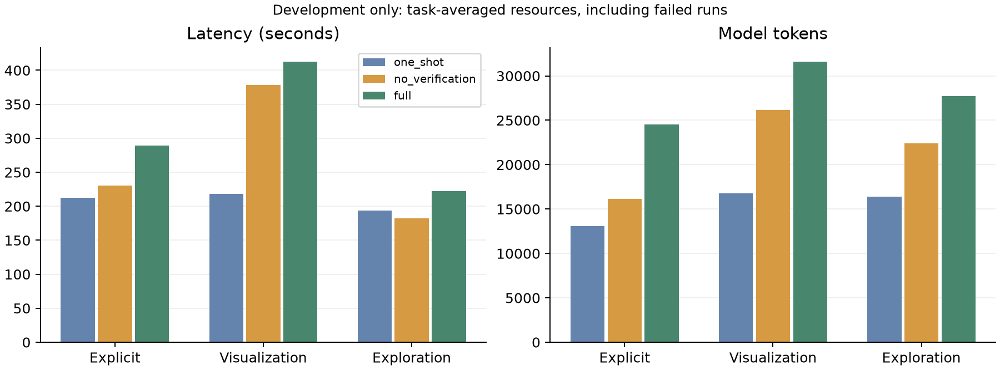

# 三条件开发对比

完整覆盖 6 个开发任务、三个条件、每条件 1 次运行，共 18 次。
数值匹配来自保存的外部参考比较；本报告不证明参考已独立复核，也没有人工整题评分。
自动检查通过、执行成功、数值表匹配和报告可用性分别呈现。探索质量仍需两位人工评分者。

| 任务／类别 | 一次生成 | 仅执行错误恢复 | 验证与修正 |
| --- | --- | --- | --- |
| D1 / 明确问题 | r0: 失败（无报告）；数值表未匹配参考 | r0: 报告已生成（未验证）；数值表匹配参考 | r0: 自动检查通过；数值表匹配参考 |
| D2 / 指定图表 | r0: 报告已生成（未验证）；数值表匹配参考 | r0: 失败（无报告）；数值表未匹配参考 | r0: 失败（无报告）；数值表未匹配参考 |
| D3 / 指定图表 | r0: 报告已生成（未验证）；数值表匹配参考 | r0: 报告已生成（未验证）；数值表匹配参考 | r0: 自动检查通过；数值表匹配参考 |
| D4 / 开放探索 | r0: 报告已生成（未验证） | r0: 报告已生成（未验证） | r0: 自动检查通过 |
| D5 / 明确问题 | r0: 报告已生成（未验证）；数值表匹配参考 | r0: 报告已生成（未验证）；数值表匹配参考 | r0: 自动检查通过；数值表匹配参考 |
| D6 / 开放探索 | r0: 失败（无报告） | r0: 失败（无报告） | r0: 失败（无报告） |

## 分类别的数值与执行结果

百分比先在每个任务内平均重复运行，再对任务等权平均；人工整题通过率尚不可用。
报告可用表示保留了所选候选报告，即使状态仍为失败。探索不提供自动整题正确率。

| 类别 | 条件 | 任务数 | 曾成功执行 | 保留报告 | 数值表匹配参考 | 图表数据和类型符合 |
| --- | --- | ---: | ---: | ---: | ---: | ---: |
| 明确问题 | 一次生成 | 2 | 50% | 50% | 50% | — |
| 明确问题 | 仅执行错误恢复 | 2 | 100% | 100% | 100% | — |
| 明确问题 | 验证与修正 | 2 | 100% | 100% | 100% | — |
| 指定图表 | 一次生成 | 2 | 100% | 100% | 100% | 100% |
| 指定图表 | 仅执行错误恢复 | 2 | 100% | 50% | 50% | 50% |
| 指定图表 | 验证与修正 | 2 | 100% | 50% | 50% | 50% |
| 开放探索 | 一次生成 | 2 | 100% | 50% | 待人工评分 | — |
| 开放探索 | 仅执行错误恢复 | 2 | 100% | 50% | 待人工评分 | — |
| 开放探索 | 验证与修正 | 2 | 100% | 50% | 待人工评分 | — |

## 已确认的失败与解释错误

四个明确／图表任务按最终保留结果计，三个条件各有3/4数值匹配；full 相比
no_verification 没有显示数值提升。该指标不能当作整题成功率，也不能掩盖各类别的差异。

- D2 的 no_verification／full 都在代码调用截断后修正并生成匹配参考的表格和柱状图，
  但报告反复附加未用 `{{...}}` 绑定的 `table.sum_quantity.0.value`，耗尽修正预算。
  上表“数值表未匹配参考”表示没有被选为最终答案的合格结果，不是已执行表格算错；
  两次 full/no_verification 运行都未进入验证阶段，不能归为验证检错成功。
- D3 三个条件的表格、有效计数和折线图匹配未复核参考，但报告都错误声称计数来自
  保存的输出行、均值来自保存的汇总表。原始CSV独立计数为17,379条观测、24个小时组；
  小时0有726条有效观测，均值53.89807162534435。full审查把两条错误局限都判为通过，
  无修正并结束为 `checks_passed`。这是明确的语义漏检，原状态未改，未代填人工评分。
  [独立核对记录](../evaluation/private/pilot-v12-D3-scope-audit.json)保留原文、审查及166个文件哈希。
- D6 三个条件都执行成功但没有最终报告。no_verification 的初稿包含未保存为计算结果的
  百分比；删除这些数字后，仍反复输出裸单元格引用，未能完成报告。full同样停在报告阶段，
  没有进入独立验证。探索题不能仅凭执行成功或计数表正确记作整题成功。

本轮所有18次的账目核对与1,066个原始文件哈希保存在
[完整网格校验](../evaluation/private/pilot-three-condition-v12-validation.json)。
v13 引用反馈在本轮全部结束后才应用；其定向复测另行记录，不更改本轮结果。

## 阶段异常与输出截断

下表是本轮实际次数与开销总和，包含后来修复的异常，不是任务等权均值或最终失败归因。
节点异常来自 trace 的 node_error；模型调用失败与节点异常可能重叠，不相加。
模型成功返回后，报告仍可能因引用绑定失败；验证发现的问题也不一定抛出节点异常。
截断 token 包含该调用的输入及输出，秒为客户端调用墙钟时间；任一截断调用缺测则总量为 —。

token 按 trace 的用量计费记录累计；没有实际用量时，保留其预留扣账，不能当作实测用量。

| 条件 | 阶段 | 节点异常 | 模型调用 | 调用失败 | 输出截断 | 截断秒（测量数） | 截断 token（计费数） |
| --- | --- | ---: | ---: | ---: | ---: | ---: | ---: |
| 一次生成 | 规划 | 0 | 6 | 0 | 0 | 0.0 (0/0) | 0 (0/0) |
| 一次生成 | 代码生成 | 0 | 6 | 0 | 0 | 0.0 (0/0) | 0 (0/0) |
| 一次生成 | 容器执行 | 1 | 0 | 0 | 0 | 0.0 (0/0) | 0 (0/0) |
| 一次生成 | 报告引用与生成 | 1 | 5 | 0 | 0 | 0.0 (0/0) | 0 (0/0) |
| 仅执行错误恢复 | 规划 | 0 | 6 | 0 | 0 | 0.0 (0/0) | 0 (0/0) |
| 仅执行错误恢复 | 代码生成 | 1 | 7 | 1 | 1 | 295.6 (1/1) | 7,680 (1/1) |
| 仅执行错误恢复 | 报告引用与生成 | 6 | 10 | 0 | 0 | 0.0 (0/0) | 0 (0/0) |
| 验证与修正 | 规划 | 0 | 6 | 0 | 0 | 0.0 (0/0) | 0 (0/0) |
| 验证与修正 | 代码生成 | 1 | 7 | 1 | 1 | 294.3 (1/1) | 7,680 (1/1) |
| 验证与修正 | 报告引用与生成 | 6 | 10 | 0 | 0 | 0.0 (0/0) | 0 (0/0) |
| 验证与修正 | 验证 | 0 | 4 | 0 | 0 | 0.0 (0/0) | 0 (0/0) |

## 资源开销

所有运行均计入，包括失败、澄清及探索。下表为任务等权均值。工具失败也消耗调用，审查消耗计入 token。
内存分别测量 worker RSS、控制器 RSS 和可见 Ollama 进程 RSS；不包含 Metal 分配与 Docker VM。
worker 内存括号为有测量的运行数／该组总运行数；不可用记为 —，不补零。

| 类别 | 条件 | 秒 | token | 工具调用 | 修正 | worker MiB（测量数） | 控制器 MiB | Ollama MiB |
| --- | --- | ---: | ---: | ---: | ---: | ---: | ---: | ---: |
| 明确问题 | 一次生成 | 212.2 | 13,050 | 2.5 | 0.0 | 93.7 (1/2) | 281.5 | 8,684.0 |
| 明确问题 | 仅执行错误恢复 | 230.6 | 16,126 | 3.0 | 0.0 | 170.2 (2/2) | 243.9 | 9,061.5 |
| 明确问题 | 验证与修正 | 289.5 | 24,530 | 4.0 | 0.0 | 170.2 (2/2) | 389.2 | 9,735.5 |
| 指定图表 | 一次生成 | 218.4 | 16,790 | 3.0 | 0.0 | 151.9 (2/2) | 248.2 | 8,901.8 |
| 指定图表 | 仅执行错误恢复 | 378.7 | 26,144 | 3.0 | 1.5 | 151.8 (2/2) | 210.1 | 8,991.0 |
| 指定图表 | 验证与修正 | 412.8 | 31,614 | 3.5 | 1.5 | 151.8 (2/2) | 215.5 | 9,483.9 |
| 开放探索 | 一次生成 | 193.9 | 16,402 | 3.0 | 0.0 | 83.8 (2/2) | 129.2 | 9,747.1 |
| 开放探索 | 仅执行错误恢复 | 182.6 | 22,414 | 3.0 | 1.0 | 83.8 (2/2) | 114.5 | 9,527.2 |
| 开放探索 | 验证与修正 | 221.9 | 27,720 | 3.5 | 1.0 | 83.8 (2/2) | 118.0 | 9,577.1 |

模型载入与推理另计：载入取服务端 `load_duration`；推理取 `prompt_eval_duration + eval_duration`。
载入指标是本轮各次调用报告的开销；本轮未安排冷启动实验，不能据此推断冷启动性能。
调用墙钟时间还包含网络、序列化及客户端开销，不将其直接称为纯推理时间。
某次运行任一调用缺少该项计时，则该运行不进入该项均值；括号为完整测量的运行数／该组总运行数。

| 类别 | 条件 | 模型载入秒 | 服务端推理秒 | 客户端模型调用秒 | 服务端计时覆盖（载入／推理／调用总数） |
| --- | --- | ---: | ---: | ---: | ---: |
| 明确问题 | 一次生成 | 0.517 (2/2) | 209.6 (2/2) | 210.8 (2/2) | 5/5/5 |
| 明确问题 | 仅执行错误恢复 | 0.006 (2/2) | 226.7 (2/2) | 229.1 (2/2) | 6/6/6 |
| 明确问题 | 验证与修正 | 0.008 (2/2) | 285.6 (2/2) | 286.3 (2/2) | 8/8/8 |
| 指定图表 | 一次生成 | 0.008 (2/2) | 216.3 (2/2) | 217.1 (2/2) | 6/6/6 |
| 指定图表 | 仅执行错误恢复 | 0.014 (2/2) | 375.9 (2/2) | 377.1 (2/2) | 9/9/9 |
| 指定图表 | 验证与修正 | 0.014 (2/2) | 410.3 (2/2) | 411.3 (2/2) | 10/10/10 |
| 开放探索 | 一次生成 | 0.006 (2/2) | 188.9 (2/2) | 193.1 (2/2) | 6/6/6 |
| 开放探索 | 仅执行错误恢复 | 0.007 (2/2) | 180.9 (2/2) | 181.8 (2/2) | 8/8/8 |
| 开放探索 | 验证与修正 | 0.014 (2/2) | 220.2 (2/2) | 221.1 (2/2) | 9/9/9 |

## 可追溯性与限制

- 实现／环境 fingerprint：`5225acd99b8cf9f23d29e0acefb71ea219e283ae00c5b869f54032f95eb65172`。
- 配置 SHA-256：`2aaf0e7ec9915e978b09d7afbe0a05fc82e004de995fc636bf468099ba4b1f70`；任务 SHA-256：`045482ab62dca46bd5f363467c190eb971cf636f397e5949bbdc59fbb88ec9a2`。
- 保存的包源码、runner、输入 CSV 哈希已核对；有效配置除条件及重复 seed 外一致。
- 这是开发任务上的小样本对比；运行按任务及条件顺序执行，没有随机化运行顺序。
- 数值匹配不验证字段解释、问题覆盖、图表可读性或探索用途；同模型审查也可能漏错或引入错误。
- 未提供 held-out 结论、人工正确率或验证效益的正式因果结论。

原始记录（保持原样）：

- [D1 / one_shot / r0](../evaluation/runs/pilot-three-condition-v12/20261103-025710-9c395ad2/evaluation.json)
- [D1 / no_verification / r0](../evaluation/runs/pilot-three-condition-v12/20261103-030021-65bcb594/evaluation.json)
- [D1 / full / r0](../evaluation/runs/pilot-three-condition-v12/20261103-030418-51e42f3d/evaluation.json)
- [D2 / one_shot / r0](../evaluation/runs/pilot-three-condition-v12/20261103-030921-06e8581a/evaluation.json)
- [D2 / no_verification / r0](../evaluation/runs/pilot-three-condition-v12/20261103-031244-b2eca36d/evaluation.json)
- [D2 / full / r0](../evaluation/runs/pilot-three-condition-v12/20261103-032218-70853482/evaluation.json)
- [D3 / one_shot / r0](../evaluation/runs/pilot-three-condition-v12/20261103-033142-747b273b/evaluation.json)
- [D3 / no_verification / r0](../evaluation/runs/pilot-three-condition-v12/20261103-033536-bdfd8360/evaluation.json)
- [D3 / full / r0](../evaluation/runs/pilot-three-condition-v12/20261103-033839-9baea906/evaluation.json)
- [D4 / one_shot / r0](../evaluation/runs/pilot-three-condition-v12/20261103-034301-024eac3d/evaluation.json)
- [D4 / no_verification / r0](../evaluation/runs/pilot-three-condition-v12/20261103-034708-91ca8c2e/evaluation.json)
- [D4 / full / r0](../evaluation/runs/pilot-three-condition-v12/20261103-035042-ceaa47d9/evaluation.json)
- [D5 / one_shot / r0](../evaluation/runs/pilot-three-condition-v12/20261103-035534-187b027e/evaluation.json)
- [D5 / no_verification / r0](../evaluation/runs/pilot-three-condition-v12/20261103-035928-979889ce/evaluation.json)
- [D5 / full / r0](../evaluation/runs/pilot-three-condition-v12/20261103-040312-52554c43/evaluation.json)
- [D6 / one_shot / r0](../evaluation/runs/pilot-three-condition-v12/20261103-040749-c5ff3b00/evaluation.json)
- [D6 / no_verification / r0](../evaluation/runs/pilot-three-condition-v12/20261103-041009-0925bb1a/evaluation.json)
- [D6 / full / r0](../evaluation/runs/pilot-three-condition-v12/20261103-041241-649d88e0/evaluation.json)
