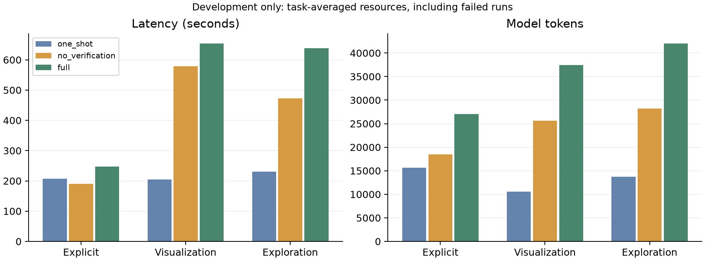

# 三条件开发对比

完整覆盖 6 个开发任务、三个条件、每条件 1 次运行，共 18 次。
数值匹配来自保存的外部参考比较；本报告不证明参考已独立复核，也没有人工整题评分。
自动检查通过、执行成功、数值表匹配和报告可用性分别呈现。探索质量仍需两位人工评分者。
下表按最终所选候选比较；无所选报告时也记为未匹配，不代表此前执行的表格一定算错。

| 任务／类别 | 一次生成 | 仅执行错误恢复 | 验证与修正 |
| --- | --- | --- | --- |
| D1 / 明确问题 | r0: 失败（无报告）；数值表未匹配参考 | r0: 报告已生成（未验证）；数值表匹配参考 | r0: 自动检查通过；数值表匹配参考 |
| D2 / 指定图表 | r0: 失败（无报告）；数值表未匹配参考 | r0: 失败（无报告）；数值表未匹配参考 | r0: 失败（无报告）；数值表未匹配参考 |
| D3 / 指定图表 | r0: 失败（无报告）；数值表未匹配参考 | r0: 报告已生成（未验证）；数值表匹配参考 | r0: 失败（无报告）；数值表未匹配参考 |
| D4 / 开放探索 | r0: 失败（无报告） | r0: 失败（无报告） | r0: 失败（无报告） |
| D5 / 明确问题 | r0: 报告已生成（未验证）；数值表匹配参考 | r0: 报告已生成（未验证）；数值表匹配参考 | r0: 自动检查通过；数值表匹配参考 |
| D6 / 开放探索 | r0: 失败（无报告） | r0: 报告已生成（未验证） | r0: 失败（保留候选报告） |

## 分类别的数值与执行结果

百分比先在每个任务内平均重复运行，再对任务等权平均；人工整题通过率尚不可用。
报告可用表示保留了所选候选报告，即使状态仍为失败。探索不提供自动整题正确率。

| 类别 | 条件 | 任务数 | 曾成功执行 | 保留报告 | 数值表匹配参考 | 图表数据和类型符合 |
| --- | --- | ---: | ---: | ---: | ---: | ---: |
| 明确问题 | 一次生成 | 2 | 100% | 50% | 50% | — |
| 明确问题 | 仅执行错误恢复 | 2 | 100% | 100% | 100% | — |
| 明确问题 | 验证与修正 | 2 | 100% | 100% | 100% | — |
| 指定图表 | 一次生成 | 2 | 0% | 0% | 0% | 0% |
| 指定图表 | 仅执行错误恢复 | 2 | 50% | 50% | 50% | 50% |
| 指定图表 | 验证与修正 | 2 | 50% | 0% | 0% | 0% |
| 开放探索 | 一次生成 | 2 | 50% | 0% | 待人工评分 | — |
| 开放探索 | 仅执行错误恢复 | 2 | 50% | 50% | 待人工评分 | — |
| 开放探索 | 验证与修正 | 2 | 50% | 50% | 待人工评分 | — |

## 阶段异常与输出截断

下表是本轮实际次数与开销总和，包含后来修复的异常，不是任务等权均值或最终失败归因。
节点异常来自 trace 的 node_error；模型调用失败与节点异常可能重叠，不相加。
模型成功返回后，报告仍可能因引用绑定失败；验证发现的问题也不一定抛出节点异常。
截断 token 包含该调用的输入及输出，秒为客户端调用墙钟时间；任一截断调用缺测则总量为 —。

token 按 trace 的用量计费记录累计；没有实际用量时，保留其预留扣账，不能当作实测用量。

| 条件 | 阶段 | 节点异常 | 模型调用 | 调用失败 | 输出截断 | 截断秒（测量数） | 截断 token（计费数） |
| --- | --- | ---: | ---: | ---: | ---: | ---: | ---: |
| 一次生成 | 规划 | 0 | 6 | 0 | 0 | 0.0 (0/0) | 0 (0/0) |
| 一次生成 | 代码生成 | 2 | 6 | 2 | 2 | 602.4 (2/2) | 15,600 (2/2) |
| 一次生成 | 容器执行 | 1 | 0 | 0 | 0 | 0.0 (0/0) | 0 (0/0) |
| 一次生成 | 报告引用与生成 | 2 | 3 | 0 | 0 | 0.0 (0/0) | 0 (0/0) |
| 仅执行错误恢复 | 规划 | 0 | 6 | 0 | 0 | 0.0 (0/0) | 0 (0/0) |
| 仅执行错误恢复 | 代码生成 | 5 | 12 | 5 | 5 | 1,479.1 (5/5) | 40,712 (5/5) |
| 仅执行错误恢复 | 容器执行 | 3 | 0 | 0 | 0 | 0.0 (0/0) | 0 (0/0) |
| 仅执行错误恢复 | 报告引用与生成 | 3 | 7 | 0 | 0 | 0.0 (0/0) | 0 (0/0) |
| 验证与修正 | 规划 | 0 | 7 | 0 | 0 | 0.0 (0/0) | 0 (0/0) |
| 验证与修正 | 代码生成 | 5 | 13 | 5 | 5 | 1,461.1 (5/5) | 40,712 (5/5) |
| 验证与修正 | 容器执行 | 3 | 0 | 0 | 0 | 0.0 (0/0) | 0 (0/0) |
| 验证与修正 | 报告引用与生成 | 4 | 8 | 0 | 0 | 0.0 (0/0) | 0 (0/0) |
| 验证与修正 | 验证 | 2 | 5 | 2 | 0 | 0.0 (0/0) | 0 (0/0) |

## 资源开销

所有运行均计入，包括失败、澄清及探索。下表为任务等权均值。工具失败也消耗调用，审查消耗计入 token。
内存分别测量 worker RSS、控制器 RSS 和可见 Ollama 进程 RSS；不包含 Metal 分配与 Docker VM。
worker 内存括号为有测量的运行数／该组总运行数；不可用记为 —，不补零。

| 类别 | 条件 | 秒 | token | 工具调用 | 修正 | worker MiB（测量数） | 控制器 MiB | Ollama MiB |
| --- | --- | ---: | ---: | ---: | ---: | ---: | ---: | ---: |
| 明确问题 | 一次生成 | 207.3 | 15,646 | 3.0 | 0.0 | 176.8 (2/2) | 270.3 | — |
| 明确问题 | 仅执行错误恢复 | 190.7 | 18,511 | 3.0 | 0.5 | 176.7 (2/2) | 250.4 | — |
| 明确问题 | 验证与修正 | 247.0 | 27,032 | 4.0 | 0.5 | 176.8 (2/2) | 353.8 | — |
| 指定图表 | 一次生成 | 204.6 | 10,586 | 1.5 | 0.0 | — (0/2) | 226.7 | — |
| 指定图表 | 仅执行错误恢复 | 578.4 | 25,620 | 2.5 | 1.5 | 76.2 (1/2) | 207.5 | — |
| 指定图表 | 验证与修正 | 654.2 | 37,433 | 3.5 | 2.0 | 76.2 (1/2) | 239.1 | — |
| 开放探索 | 一次生成 | 230.0 | 13,718 | 2.0 | 0.0 | 90.4 (1/2) | 118.3 | — |
| 开放探索 | 仅执行错误恢复 | 472.6 | 28,182 | 3.0 | 2.5 | 90.3 (1/2) | 114.3 | — |
| 开放探索 | 验证与修正 | 637.8 | 42,036 | 4.5 | 3.0 | 97.2 (1/2) | 135.5 | — |

模型载入与推理另计：载入取服务端 `load_duration`；推理取 `prompt_eval_duration + eval_duration`。
载入指标是本轮各次调用报告的开销；本轮未安排冷启动实验，不能据此推断冷启动性能。
调用墙钟时间还包含网络、序列化及客户端开销，不将其直接称为纯推理时间。
某次运行任一调用缺少该项计时，则该运行不进入该项均值；括号为完整测量的运行数／该组总运行数。

| 类别 | 条件 | 模型载入秒 | 服务端推理秒 | 客户端模型调用秒 | 服务端计时覆盖（载入／推理／调用总数） |
| --- | --- | ---: | ---: | ---: | ---: |
| 明确问题 | 一次生成 | 0.520 (2/2) | 204.8 (2/2) | 205.8 (2/2) | 6/6/6 |
| 明确问题 | 仅执行错误恢复 | 0.008 (2/2) | 186.8 (2/2) | 189.2 (2/2) | 7/7/7 |
| 明确问题 | 验证与修正 | 0.007 (2/2) | 243.3 (2/2) | 244.0 (2/2) | 9/9/9 |
| 指定图表 | 一次生成 | 0.006 (2/2) | 203.6 (2/2) | 204.0 (2/2) | 4/4/4 |
| 指定图表 | 仅执行错误恢复 | 0.013 (2/2) | 576.8 (2/2) | 577.5 (2/2) | 8/8/8 |
| 指定图表 | 验证与修正 | 0.011 (2/2) | 652.2 (2/2) | 653.2 (2/2) | 10/10/10 |
| 开放探索 | 一次生成 | 0.004 (2/2) | 228.6 (2/2) | 229.5 (2/2) | 5/5/5 |
| 开放探索 | 仅执行错误恢复 | 0.017 (2/2) | 470.8 (2/2) | 471.6 (2/2) | 10/10/10 |
| 开放探索 | 验证与修正 | 0.016 (2/2) | 633.6 (2/2) | 636.4 (2/2) | 14/14/14 |

## 可追溯性与限制

- 实现／环境 fingerprint：`ba3f63e2dc8e80331cba67a166cdc6734f4dfb66489595ffe7726af3034ec618`。
- 配置 SHA-256：`2aaf0e7ec9915e978b09d7afbe0a05fc82e004de995fc636bf468099ba4b1f70`；任务 SHA-256：`045482ab62dca46bd5f363467c190eb971cf636f397e5949bbdc59fbb88ec9a2`。
- 保存的包源码、runner、输入 CSV 哈希已核对；有效配置除条件及重复 seed 外一致。
- 这是开发任务上的小样本对比；运行按任务及条件顺序执行，没有随机化运行顺序。
- 数值匹配不验证字段解释、问题覆盖、图表可读性或探索用途；同模型审查也可能漏错或引入错误。
- 未提供 held-out 结论、人工正确率或验证效益的正式因果结论。

原始记录（保持原样）：

- [D1 / one_shot / r0](../evaluation/runs/pilot-three-condition-v15/20261107-230149-0329e5a3/evaluation.json)
- [D1 / no_verification / r0](../evaluation/runs/pilot-three-condition-v15/20261107-230440-72e2d366/evaluation.json)
- [D1 / full / r0](../evaluation/runs/pilot-three-condition-v15/20261107-230715-44d3812f/evaluation.json)
- [D2 / one_shot / r0](../evaluation/runs/pilot-three-condition-v15/20261107-231044-3572de8c/evaluation.json)
- [D2 / no_verification / r0](../evaluation/runs/pilot-three-condition-v15/20261107-231602-d8e584d4/evaluation.json)
- [D2 / full / r0](../evaluation/runs/pilot-three-condition-v15/20261107-232610-b15923f5/evaluation.json)
- [D3 / one_shot / r0](../evaluation/runs/pilot-three-condition-v15/20261107-233611-aab21b2d/evaluation.json)
- [D3 / no_verification / r0](../evaluation/runs/pilot-three-condition-v15/20261107-233743-8b7498db/evaluation.json)
- [D3 / full / r0](../evaluation/runs/pilot-three-condition-v15/20261107-234653-90b0c0bf/evaluation.json)
- [D4 / one_shot / r0](../evaluation/runs/pilot-three-condition-v15/20261107-235841-630aa1b7/evaluation.json)
- [D4 / no_verification / r0](../evaluation/runs/pilot-three-condition-v15/20261108-000418-cde97108/evaluation.json)
- [D4 / full / r0](../evaluation/runs/pilot-three-condition-v15/20261108-001751-f3027874/evaluation.json)
- [D5 / one_shot / r0](../evaluation/runs/pilot-three-condition-v15/20261108-003109-b1458b8e/evaluation.json)
- [D5 / no_verification / r0](../evaluation/runs/pilot-three-condition-v15/20261108-003513-ff105e4e/evaluation.json)
- [D5 / full / r0](../evaluation/runs/pilot-three-condition-v15/20261108-003859-4cdd8598/evaluation.json)
- [D6 / one_shot / r0](../evaluation/runs/pilot-three-condition-v15/20261108-004344-424d63f0/evaluation.json)
- [D6 / no_verification / r0](../evaluation/runs/pilot-three-condition-v15/20261108-004548-7d7d27b9/evaluation.json)
- [D6 / full / r0](../evaluation/runs/pilot-three-condition-v15/20261108-004800-15e8f27a/evaluation.json)

## 本轮具体结果与失败审计

本轮是当前v15实现的一轮完整开发比较。使用预先记录的六任务×三条件×一次重复，
同一源码、配置、输入、参考与环境，共18次。全部终止记录与token／工具账目已经核对；
1,043个原始运行文件保存了哈希，历史v12／v13／v14的1,321个文件核对未变。
所有运行合计6,845.4秒（114.1分钟）、437,528个模型token，包含失败。
12次代码输出截断合计3,542.6秒、97,024个输入及输出token；这些只是截断调用的开销，
不是所有失败成本，也不与节点异常重复相加。模型进程RSS在18次运行中均因读取权限而
不可用，没有补零；worker与控制器测量分别列出。

按最终保留报告计算，四个明确／图表题的数值匹配为1/4、3/4、2/4；full没有显示整体
数值优势。两道明确题分别1/2、2/2、2/2，图表题0/2、1/2、0/2。每类别只有两题、
每格一次，参考未独立复核，不能把这些数值当作人工整题通过率或正式效益结论。

- **D1：算对但未交付。** 一次生成的实际表格匹配参考，但报告加入无依据的“10000”
  范围数字，被绑定检查拒绝，所以最终评分没有选中报告。两个恢复条件修正报告后交付；
  full内部检查通过。不能把一次生成的最终失败描述成计算错误。
- **D2：没有执行。** 三个条件的初始代码输出均截断；两个恢复条件各再截断一次，
  因重复失败停止。没有生成可执行分析，不能归因于数值验证拒绝正确计算。
- **D3：执行恢复与审查失败。** 一次生成因结果列数不匹配停止。另两个条件经历一次
  截断后，第二次代码修正成功，小时均值、有效计数和折线图数据／类型匹配参考。
  仅错误恢复保留报告，但错误声称统计基于保存的汇总行；源CSV有17,379条、24小时组，
  小时0有726条有效观测。full的两次语义响应均遗漏失败覆盖判断的必填修正建议，
  最终没有有效审查或所选报告；原始响应还接受了上述错误局限，不能称作正式语义通过。
- **D4：代码生成／执行未恢复。** 一次生成截断；另两个条件均经历截断、两次pandas
  聚合接口错误、最后一次截断，用完三次修正，均未生成报告或进入验证。
- **D5：三个条件均交付。** 未加权工时表匹配参考，均未修正；full内部检查通过。
  图表可读性和整题评分仍不能从这个状态推出。
- **D6：检出遗漏，仍未完成恢复。** 一次生成执行成功后报告失败。仅错误恢复修复
  未支持的百分比和裸引用后交付，但只给三个总体缺失数，没有展开类别差异。
  full明确检出该遗漏并第三次修正计划。真实trace记录上下文清理，新代码输入的旧代码
  与反馈为空、旧结果表为空；旧产物保留。新代码执行成功，但报告仍因“<=50K”等
  未绑定数字不合法而失败，最终保留此前有覆盖失败的attempt-02，不提升新候选。

D6新代码的事后独立计划比较三表均失败：两个计数表忽略排序后匹配，工时表仍不匹配，
因为把按workclass索引的计数赋到数字索引结果，八组valid_count全为空；三个声明的
升序排序均未实现。新计划也去掉了原缺失分析，count(income)按教育／race分组只是
计数非缺失收入记录，没有按收入结果分组或筛选。新报告把HS-grad总人数15,784误说成
<=50K人数，CSV实际为13,281；White总人数41,762误说成<=50K人数，实际为31,155。
这些是开发者事后事实诊断，没有放宽验收、重跑模型、改写原始状态或代填人工评分。

可检查的独立记录：

- [完整核验及原始文件哈希](../evaluation/private/pilot-three-condition-v15-validation.json)
- [当前机器可读证据](../report/development-evidence-v15.json)
- [D3源记录／汇总行诊断](../evaluation/private/pilot-v15-D3-scope-audit.json)
- [D6重规划与错误计数诊断](../evaluation/private/pilot-v15-D6-replan-audit.json)
- [预先记录的运行计划](../evaluation/private/pilot-three-condition-v15-plan.json)
- [服务停止后的离线续跑核验](../evaluation/private/pilot-three-condition-v15-offline-resume.json)

停止临时模型服务后，同一批次--resume保留全部18格及stdout，新增调用为零。匿名包
位于evaluation/private/blind-pilot-three-condition-v15；18案例、两份各22行空白评分表，
不含已填人工分数。独立复核、正式冻结、held-out推理及双人评分仍未完成。
本轮Ollama／执行镜像环境与历史批次不同，不与v12／v13／v14合并或作单补丁因果比较。
