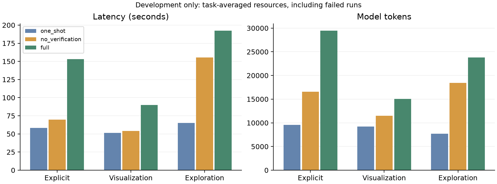

# 三条件开发对比

完整覆盖 6 个开发任务、三个条件、每条件 1 次运行，共 18 次。
数值匹配来自保存的外部参考比较；本报告不证明参考已独立复核，也没有人工整题评分。
自动检查通过、执行成功、数值表匹配和报告可用性分别呈现。探索质量仍需两位人工评分者。

| 任务／类别 | 一次生成 | 仅执行错误恢复 | 验证与修正 |
| --- | --- | --- | --- |
| D1 / 明确问题 | r0: 失败（无报告）；数值表未匹配参考 | r0: 报告已生成（未验证）；数值表未匹配参考 | r0: 失败（保留候选报告）；数值表未匹配参考 |
| D2 / 指定图表 | r0: 报告已生成（未验证）；数值表匹配参考 | r0: 报告已生成（未验证）；数值表匹配参考 | r0: 自动检查通过；数值表匹配参考 |
| D3 / 指定图表 | r0: 失败（无报告）；数值表未匹配参考 | r0: 失败（无报告）；数值表未匹配参考 | r0: 失败（无报告）；数值表未匹配参考 |
| D4 / 开放探索 | r0: 失败（无报告） | r0: 报告已生成（未验证） | r0: 自动检查通过 |
| D5 / 明确问题 | r0: 报告已生成（未验证）；数值表匹配参考 | r0: 报告已生成（未验证）；数值表匹配参考 | r0: 自动检查通过；数值表匹配参考 |
| D6 / 开放探索 | r0: 失败（无报告） | r0: 失败（无报告） | r0: 失败（无报告） |

## 分类别的数值与执行结果

百分比先在每个任务内平均重复运行，再对任务等权平均；人工整题通过率尚不可用。
报告可用表示保留了所选候选报告，即使状态仍为失败。探索不提供自动整题正确率。

| 类别 | 条件 | 任务数 | 曾成功执行 | 保留报告 | 数值表匹配参考 | 图表数据和类型符合 |
| --- | --- | ---: | ---: | ---: | ---: | ---: |
| 明确问题 | 一次生成 | 2 | 50% | 50% | 50% | — |
| 明确问题 | 仅执行错误恢复 | 2 | 100% | 100% | 50% | — |
| 明确问题 | 验证与修正 | 2 | 100% | 100% | 50% | — |
| 指定图表 | 一次生成 | 2 | 50% | 50% | 50% | 50% |
| 指定图表 | 仅执行错误恢复 | 2 | 50% | 50% | 50% | 50% |
| 指定图表 | 验证与修正 | 2 | 50% | 50% | 50% | 50% |
| 开放探索 | 一次生成 | 2 | 0% | 0% | 待人工评分 | — |
| 开放探索 | 仅执行错误恢复 | 2 | 50% | 50% | 待人工评分 | — |
| 开放探索 | 验证与修正 | 2 | 50% | 50% | 待人工评分 | — |

## 资源开销

所有运行均计入，包括失败、澄清及探索。下表为任务等权均值。工具失败也消耗调用，审查消耗计入 token。
内存分别测量 worker RSS、控制器 RSS 和可见 Ollama 进程 RSS；不包含 Metal 分配与 Docker VM。
worker 内存括号为有测量的运行数／该组总运行数；不可用记为 —，不补零。

| 类别 | 条件 | 秒 | token | 工具调用 | 修正 | worker MiB（测量数） | 控制器 MiB | Ollama MiB |
| --- | --- | ---: | ---: | ---: | ---: | ---: | ---: | ---: |
| 明确问题 | 一次生成 | 58.2 | 9,577 | 2.5 | 0.0 | 92.4 (1/2) | 272.4 | 8,412.1 |
| 明确问题 | 仅执行错误恢复 | 69.8 | 16,541 | 3.5 | 1.0 | 163.0 (2/2) | 286.3 | 8,909.9 |
| 明确问题 | 验证与修正 | 152.9 | 29,476 | 5.5 | 1.5 | 163.0 (2/2) | 403.1 | 9,301.0 |
| 指定图表 | 一次生成 | 51.3 | 9,214 | 2.5 | 0.0 | 224.1 (1/2) | 250.9 | 8,974.1 |
| 指定图表 | 仅执行错误恢复 | 54.2 | 11,496 | 3.5 | 1.0 | 224.3 (1/2) | 226.8 | 8,746.8 |
| 指定图表 | 验证与修正 | 89.9 | 15,070 | 4.0 | 1.0 | 224.4 (1/2) | 335.9 | 8,716.8 |
| 开放探索 | 一次生成 | 65.0 | 7,706 | 2.0 | 0.0 | — (0/2) | 110.8 | 8,567.5 |
| 开放探索 | 仅执行错误恢复 | 155.4 | 18,446 | 4.5 | 2.0 | 79.7 (1/2) | 113.1 | 8,766.7 |
| 开放探索 | 验证与修正 | 192.4 | 23,827 | 5.0 | 2.0 | 79.7 (1/2) | 121.1 | 9,007.5 |

模型载入与推理另计：载入取服务端 `load_duration`；推理取 `prompt_eval_duration + eval_duration`。
载入指标是本轮各次调用报告的开销；本轮未安排冷启动实验，不能据此推断冷启动性能。
调用墙钟时间还包含网络、序列化及客户端开销，不将其直接称为纯推理时间。
某次运行任一调用缺少该项计时，则该运行不进入该项均值；括号为完整测量的运行数／该组总运行数。

| 类别 | 条件 | 模型载入秒 | 服务端推理秒 | 客户端模型调用秒 | 服务端计时覆盖（载入／推理／调用总数） |
| --- | --- | ---: | ---: | ---: | ---: |
| 明确问题 | 一次生成 | 0.394 (2/2) | 56.0 (2/2) | 56.9 (2/2) | 5/5/5 |
| 明确问题 | 仅执行错误恢复 | 0.007 (2/2) | 67.5 (2/2) | 68.0 (2/2) | 8/8/8 |
| 明确问题 | 验证与修正 | 0.013 (2/2) | 147.5 (2/2) | 148.6 (2/2) | 12/12/12 |
| 指定图表 | 一次生成 | 0.005 (2/2) | 49.4 (2/2) | 50.1 (2/2) | 5/5/5 |
| 指定图表 | 仅执行错误恢复 | 0.006 (2/2) | 52.2 (2/2) | 52.7 (2/2) | 7/7/7 |
| 指定图表 | 验证与修正 | 0.007 (2/2) | 86.9 (2/2) | 87.3 (2/2) | 8/8/8 |
| 开放探索 | 一次生成 | 0.005 (2/2) | 63.9 (2/2) | 64.3 (2/2) | 4/4/4 |
| 开放探索 | 仅执行错误恢复 | 0.009 (2/2) | 153.4 (2/2) | 154.0 (2/2) | 9/9/9 |
| 开放探索 | 验证与修正 | 0.010 (2/2) | 189.0 (2/2) | 191.0 (2/2) | 10/10/10 |

## 可追溯性与限制

- 实现／环境 fingerprint：`fccdd3f0214c7c3bbae7de38c2a2acc03486f1cdd1255b8ed2acb73c5260c36f`。
- 配置 SHA-256：`982ea48c0645e7debed254b1b3ebd4e460f659227148ea531cc90c2d997b13c3`；任务 SHA-256：`045482ab62dca46bd5f363467c190eb971cf636f397e5949bbdc59fbb88ec9a2`。
- 保存的包源码、runner、输入 CSV 哈希已核对；有效配置除条件及重复 seed 外一致。
- 这是开发任务上的小样本对比；运行按任务及条件顺序执行，没有随机化运行顺序。
- 数值匹配不验证字段解释、问题覆盖、图表可读性或探索用途；同模型审查也可能漏错或引入错误。
- 未提供 held-out 结论、人工正确率或验证效益的正式因果结论。

原始记录（保持原样）：

- [D1 / one_shot / r0](../evaluation/runs/pilot-three-condition-v8/20261103-013331-b305d9ef/evaluation.json)
- [D1 / no_verification / r0](../evaluation/runs/pilot-three-condition-v8/20261103-013427-fd81c32e/evaluation.json)
- [D1 / full / r0](../evaluation/runs/pilot-three-condition-v8/20261103-013610-4c690ecf/evaluation.json)
- [D2 / one_shot / r0](../evaluation/runs/pilot-three-condition-v8/20261103-013937-7f375a49/evaluation.json)
- [D2 / no_verification / r0](../evaluation/runs/pilot-three-condition-v8/20261103-014043-7a130c00/evaluation.json)
- [D2 / full / r0](../evaluation/runs/pilot-three-condition-v8/20261103-014135-5a0449de/evaluation.json)
- [D3 / one_shot / r0](../evaluation/runs/pilot-three-condition-v8/20261103-014340-987d052d/evaluation.json)
- [D3 / no_verification / r0](../evaluation/runs/pilot-three-condition-v8/20261103-014417-261e9125/evaluation.json)
- [D3 / full / r0](../evaluation/runs/pilot-three-condition-v8/20261103-014513-006d36d1/evaluation.json)
- [D4 / one_shot / r0](../evaluation/runs/pilot-three-condition-v8/20261103-014608-6c2dbcd4/evaluation.json)
- [D4 / no_verification / r0](../evaluation/runs/pilot-three-condition-v8/20261103-014652-3c0eee96/evaluation.json)
- [D4 / full / r0](../evaluation/runs/pilot-three-condition-v8/20261103-014835-b0807800/evaluation.json)
- [D5 / one_shot / r0](../evaluation/runs/pilot-three-condition-v8/20261103-015133-8f4a475c/evaluation.json)
- [D5 / no_verification / r0](../evaluation/runs/pilot-three-condition-v8/20261103-015233-c51d6886/evaluation.json)
- [D5 / full / r0](../evaluation/runs/pilot-three-condition-v8/20261103-015311-ab4e7bea/evaluation.json)
- [D6 / one_shot / r0](../evaluation/runs/pilot-three-condition-v8/20261103-015449-d5409308/evaluation.json)
- [D6 / no_verification / r0](../evaluation/runs/pilot-three-condition-v8/20261103-015615-ae6adb72/evaluation.json)
- [D6 / full / r0](../evaluation/runs/pilot-three-condition-v8/20261103-015943-c2f3aaf4/evaluation.json)
