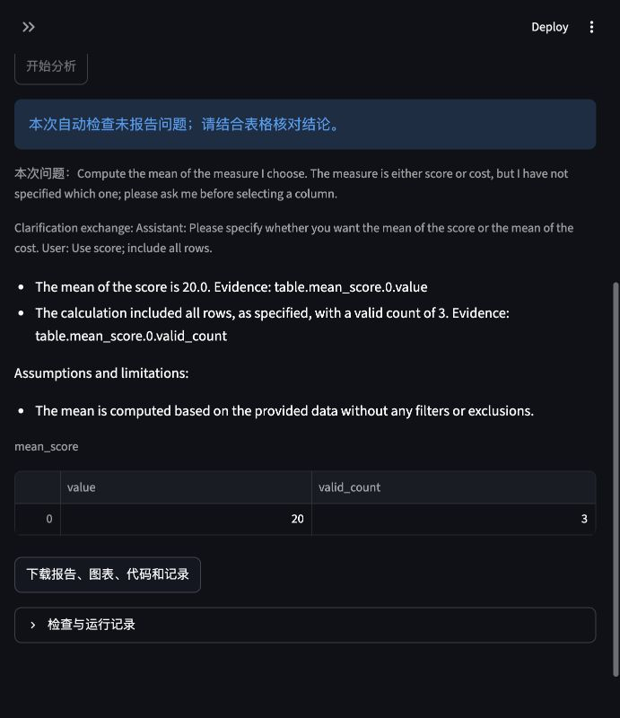

# 定向开发 v10 与澄清／缺失率修复 v11

这份记录承接固定三条件的 [v8 开发比较](DEV_COMPARISON_V8_ZH.md)。
后续版本分别保存，不能合并成新的六任务准确率；独立参考复核和两位人工评分仍未完成。

## v10：代码阶段启用 thinking 的两项试跑

目录：`evaluation/runs/pilot-code-thinking-v10`。
仅 D1、D6，full 条件，各一次重复；没有重新运行三条件完整网格。
`config/pilot-code-thinking-v10.json`在代码生成和语义审查阶段启用 thinking，
规划／报告不启用。输出上限、工具／修正／累计 token 预算与开发配置相同。
默认 `config/development.json`仍只在审查阶段启用 thinking。

| 开发任务 | 实际观察 | 墙钟秒 | 模型 token | 修正 |
| --- | --- | ---: | ---: | --- |
| D1 一月各国销售额 | 首次计算已匹配未复核参考的22个国家；报告删除无依据的范围数字后内部通过 | 225.8 | 26,387 | 1次，仅报告 |
| D6 Adult 缺失探索 | 首次执行后排序不符，重写代码后数值表通过声明计划重算；最终解释仍有错误，语义审查漏检 | 589.2 | 47,510 | 1次，代码 |

D1 的修正没有改善数值表，不能记为数值恢复。D6 不再重复旧的非法 `astype` 调用，
但计算与计划相符并不代表报告解释正确。

保存的 workclass 表中，White 为2311条缺失／41762条总记录，约5.53%；
Other 为31／406，约7.64%。occupation 中相应数字为2318／41762和31／406。
最终报告却把 White 的最多缺失数量称为最高缺失率；图轴也把整数数量标成 Missing Rate。
这两个比值反例足以否定该排名，原语义审查仍给出了 pass。
没有据此代填任何人工 rubric 分数。

两项运行期间源码、runner、配置和容器镜像固定。结束后已核对完整两格、输入及源码
快照哈希、逐阶段 thinking 和配置；环境指纹为
`a8d38829083d3e104df76a4ff0883264ebb14411a8e1a545ba8f7c6a1b4ad3a8`。
结构化汇总、具体反例分别保存在
`evaluation/private/summary-code-thinking-v10.json`和`semantic-rate-audit-v10.json`。
原始运行状态仍是当时的 `checks_passed`，这里明确记录其语义错误。

## v11：固定澄清回复与有界错误检查

`Agent.run(clarification_response=...)`与评估 runner 支持一次预写回复。
首次规划看不到回复；模型实际提出澄清后，保存该计划及问答，在同一运行中再次规划。
不重新 profile、不重置工具／token 计费，也不把正常回复计作一次错误修正。
无回复、第二次澄清或预算耗尽都会停止。后续报告和审查使用包含实际回复的有效问题。
CLI 对应选项为 `--clarification-response`；交互界面原有的修改问题后重提方式仍可使用。

任务可声明 `answer`、`clarification`或`clarification_then_answer`。
最后一种必须提供非空固定回复，runner 在任何推理前校验全部选中任务。
是否遵循交互协议与答案质量分别记录；漏掉必需澄清时，人工高分不能覆盖明确题／图表的
协议失败。终止式澄清有独立指标，不进入数值答案及实质回答的成功率分母。
盲评材料只包含实际问答，未用回复、原始路径和条件标签不会加入分发文件。
正式42项草稿保持原样，交互案例和回复还需真实团队复核后确定。

新增缺失率检查仅用于 full 条件。它对明确绑定缺失数量行的部分中英文极值陈述，
按各组 `value / valid_count` 的精确分数寻找反例；对缺失数量图表的明确率单位给出计划错误。
存在反例即失败；未找到反例、无分母、零分母、含糊／否定／名次陈述标为未覆盖。
此检查不能证明一般比例、总体范围、类别含义或任意自然语言解释。
它没有改写模型代码、表格或报告，仍由模型根据反馈修正。

用新检查只读回放 v10，D6 选中结果检出两个错误率排名及三个错误图表单位，
D1 选中报告没有这些失败。诊断在
`evaluation/private/missing-rate-check-audit-v11.json`，记录输入与检查器哈希；
回放前后核对了原始目录全部文件哈希。原始结果／状态／评分未改，
回放不是重新推理，也不是已经观察到模型成功修复 D6。

## 验证与实际小样例

全部311项测试（含真实 Docker）和 Ruff 通过。新回归覆盖澄清续跑及累计预算、
未用回复不泄露、再次提问停止、盲评问答、人工评分约束、独立澄清指标，
以及分母改变排名、精确大整数分数、图表单位和含糊陈述。
控制器回归还复现“模型审查错误给 pass”，确认程序失败仍触发只改报告的修正，
并复用已有计算；该回归使用受控模型，不是实际模型准确率证据。

真实 Qwen3／Ollama／Docker 另外完成一个三行合成开发样例：
score 为10、20、30，cost 为100、300、500，初始问题未指定选择哪列。
模型先问选择 score 还是 cost，收到固定回复“Use score; include all rows.”后继续，
计算得到均值20、有效记录3，内部检查通过。
同一次运行有两次规划、一次 profile、一次执行、一次验证，0次错误修正，
共55.7秒、13,449 token；所有五次模型调用之和与累计计费一致。

运行目录：`runs/clarification-smoke-v11/20261103-024223-0ef86f91`。
源码快照、初次负载未含回复、最终均值／计数、累计计费以及匿名包的实际问答已逐项核对，
记录在`evaluation/private/clarification-smoke-v11-validation.json`。
对应盲评包`evaluation/private/clarification-smoke-v11-blind`的两张评分表保持空白。
这是合成数据的集成验证，不计入六个开发任务或正式研究成绩。

重启后的 Streamlit 健康端点为200；在现有浏览器标签中刷新并打开该真实结果，
确认实际澄清回复、均值20和有效计数3可见。通过页面下载的 ZIP 通过完整性检查，
保留澄清原计划与问答，排除原始 CSV。界面截图如下：



真实容器测试命令使用 Colima 已共享的项目临时目录：

```bash
MPLCONFIGDIR="$PWD/.cache/matplotlib" TABULAR_DOCKER_TESTS=1 \
  .venv/bin/python -m pytest -q --basetemp=.cache/pytest-v11
.venv/bin/ruff check src evaluation tests app.py scripts
```

默认 macOS 临时目录不在本机 Colima 挂载范围，首次全量测试因此出现11个挂载失败；
改用上述目录后311项全部通过，没有放宽执行隔离或修改测试断言。
后续仍需真实参考／家族复核、选择和冻结设置、完整 held-out 运行及双人评分。
