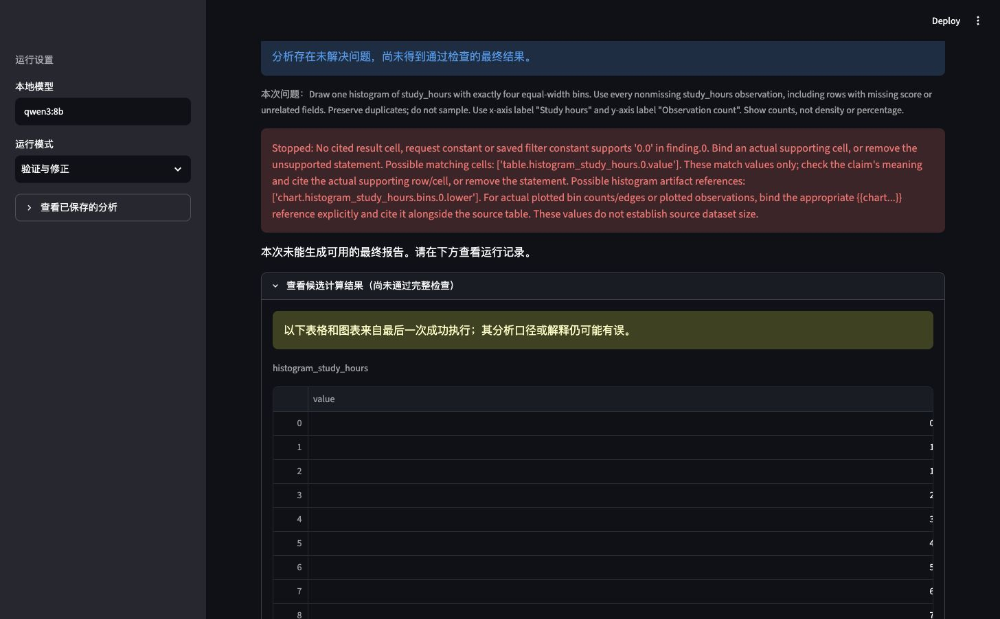
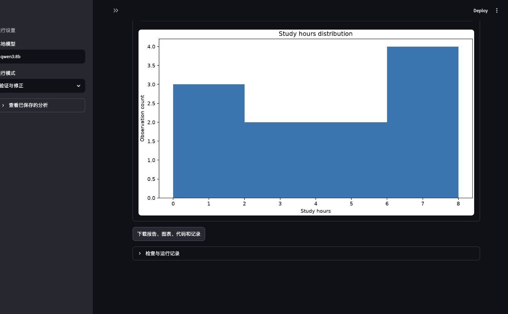

# v19：向报告提供真实直方图证据

## 结果

已补齐实际分箱值到报告／审查的传递；456项测试（含真实Docker）和Ruff通过。
一次预先登记的Chrome流程已结束：上传、计算、绘图、候选显示和ZIP下载完成，
报告仍失败。不能称为直方图整题恢复，也没有新的三条件准确率或人工评分。

## 定位与实现

v18最终直方图的真实箱计数为3、2、2、4，但报告曾写成1、2、2、6。此前报告模型只看到
原始观测表，未收到绘图artist的实际计数；原始表的value是测量值，不是箱计数。
相同数字可能同时出现在两种量中，仅按数字相等绑定不能区分其单位。

新增`chart_evidence.py`从保存的artist metadata生成具名证据：

- `chart.ID.observations`：实际绘图计数之和。
- `chart.ID.bin_count`：箱数量。
- `chart.ID.bins.INDEX.count`：各箱计数；边界使用`lower`或`upper`。

报告生成与审查共用最多40箱的预览，包括末箱上边界是否包含、截断标志和绑定示例；
完整证据另存`attempt-XX/chart_evidence.json`。数值绑定、渲染、审查可见文本及保存结果
诊断工具都接收实际metadata。截断预览不截断底层解析器的来源。
无metadata、未知／非规范引用、非法计数／边界、重复ID被拒绝；每条发现仍需表格证据，
绑定的chart标量也必须引用。同值测量与箱计数竞争时拒绝猜选。
报告／审查重试复用原计算及图表，保留候选、累计预算和审查历史。

直方图一致性检查从声明的箱数重新计算等宽边界；此前直接沿用metadata边界，
会漏掉某些计数不变的非等宽改动。该检查只核对保存表到图的关系。

## 验证

新增25项测试覆盖具名引用、缺少来源／引用、同值歧义、非法metadata、空直方图、
截断预览、三个控制器条件、报告重试与审查历史、保存结果的诊断回放。
全套456项通过，无跳过；日志为`.cache/pytest-histogram-v19-final.log`和同名XML。
模拟模型测试不是实际模型恢复证据。

真实任务沿用`data/smoke/chart-types-v18/data.csv`与原直方图问题，应用默认配置、
full条件、一次运行，没有选择性重跑。预登记：
`evaluation/private/histogram-evidence-v19-plan.json`。

| 项目 | 实际结果 |
| --- | --- |
| 运行 | `runs/20261108-140116-783bd49a/` |
| 原始记录／绘图观察 | 12／11；只排除缺少study_hours的记录，保留重复值 |
| 等宽边界／计数 | 0、2、4、6、8／3、2、2、4 |
| 标签 | Study hours／Observation count |
| 模型调用 | 规划、代码、报告、报告修正，共4次 |
| 终止状态 | failed；3次工具、1次报告修正，未进入语义审查 |
| 成本 | 14,105模型token；59.921秒，失败计入 |
| 导出 | 58个ZIP条目逐项匹配运行文件，排除原始data.csv |

两版候选报告确实写出了正确计数，但使用未绑定的边界数字，并遗漏来源表引用。
第一处失败为`0.0`没有被引用证据支持；修正版重复了相同报告，仍被拒绝。后续问题
没有因为第一处报错而自动消失。没有合法最终报告，也没有语义审查通过判断。
这证明实际分箱值已传入报告模型，同时显示报告合同仍不可靠；不是补丁效果的因果比较。

Chrome实际上传158字节CSV，显示失败状态、候选表格和图表，并下载`analysis (6).zip`。
项目内副本：`evaluation/private/histogram-evidence-v19-browser.zip`；下载回执为
`evaluation/private/histogram-evidence-v19-browser-download.json`。开发者目视检查不替代人工评分。

## 保留与限制

开工前登记的9,808个历史运行文件逐项哈希未变，包含此前全部失败与成本。
新运行独立保存源码、输入和模型响应，未改写v18或v15结果。最终校验回执为
`evaluation/private/histogram-evidence-v19-validation.json`。

具名值不能证明文字引用了正确的箱、单位或解释。原始观测行相对于源CSV的独立重算
仍未覆盖；绘图观察数不自动等于原始样本量；图表可读性仍需人工评分。
完整开发比较仍为v15。真实参考／任务家族复核、正式冻结、held-out推理和双人评分仍未
完成，用户已安排稍后处理，不代填这些工作。
