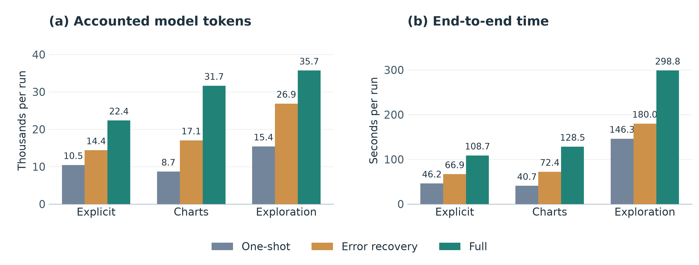

# v7正式实验：自动结果

更新：2026-11-18。252/252次正式运行已结束，全部失败保留，没有挑选重试。
这是自动结果，整题质量、图表可读性、探索用途和评分者一致性仍等两位队友独立评分。
评分前不要把本文或条件对应关系发给评分者。

## 实验与证据

- 42输入×三条件×两次重复；22道明确统计、14道图表、6道探索。
- Qwen3.5-9B Q4，全部阶段非思考；配置、源码、数据、参考及环境先冻结再运行。
- 8个保守连接任务家族；含探索任务的家族仅4个，不能把252次运行当252个独立样本。
- 完整性检查通过：17,829个运行文件、129个批次快照文件；终态、预算及固定网格一致。
- 本地证据目录：`evaluation/private/formal-v7-automatic-evidence/`。
- 批次：`evaluation/runs/formal-qwen35-9b-v7-20261117`。
- 冻结SHA-256：`e3b049f425f0b6f492597e0ef60c59590ebf979e25cea2ad3e7b1a7f8e9cbadb`。
- 完成批次SHA-256：`5ab245d928a1a800db1029e5d398c1eaa26068f64be43b4aadbbf042d366164f`。

## 数值匹配与交付

| 自动指标 | 单次生成 | 仅错误恢复 | 完整验证 |
| --- | ---: | ---: | ---: |
| 明确统计：所选数值表匹配 | 21/44（47.7%） | 26/44（59.1%） | 27/44（61.4%） |
| 图表题：所选数值表匹配 | 5/28（17.9%） | 12/28（42.9%） | 14/28（50.0%） |
| 明确统计：有报告 | 24/44 | 32/44 | 30/44 |
| 图表题：有报告 | 8/28 | 19/28 | 19/28 |
| 探索：有报告 | 1/12 | 9/12 | 5/12 |
| 全部84次的token合计 | 888,793 | 1,433,807 | 2,299,457 |
| 每次平均秒数 | 58.7 | 84.9 | 142.5 |

数值匹配指所选候选中至少一张表与完整参考一致，不保证额外分析或解释正确。
没有所选输出计为最终数值不匹配，即使早先候选算对过。图表数组匹配数也是5、12、14，
标签单位、可读性和整题通过另评。探索没有唯一数值答案；有报告也不等于有用。

全批次913次模型调用均记录了token，共4,622,057；各运行耗时合计24,027.74秒。
外部参考审计费用另记，不计入三条件成本。时间包含失败，且有顺序、缓存及其他本机
文档工作的影响，不作为独占主机或冷启动性能比较。

完整验证比单次生成多6个明确题、9个图表题数值匹配，token约为2.59倍；
比仅错误恢复多1个、2个匹配，token约为1.60倍。它的探索报告交付少于仅错误恢复。
因此，目前只能说这些输入上的数值匹配改善，尚不能断言整体质量提升值得其成本。

## 修正、变体及实际失败

完整验证的72次确定题中，13/44个初始未匹配候选变成最终匹配，28个初始匹配候选无
最终数值回退。初始未匹配包括未生成或执行失败，不能把13次都称为修正了错误计算，
更不能把这个数字当人工整题修复成功率。

配对变体先平均每个输入的两次重复，再与干净版本比较。完整验证的数字字符串、缺失值、
混合日期平均变化分别为0、0、-50个百分点；仅有4、6、2对，且有共用干净题和家族依赖。
零均值可能是正负抵消，也可能两边都失败。描述性家族区间及逐对结果保留在证据目录。

三个可追溯的案例（均为事后诊断，未据此修改冻结系统）：

- `R01/full/repeat=0`：初始按国家求取消记录的Quantity之和，计算检查通过但未回答计数请求；
  同模型审查指出口径错误，一次计划／代码修正后完整表匹配。
  运行`20261117-192116-e469af04`，前后计划、表和审查反馈均保留。
- `V08/full/repeat=0`：混合日期没有声明转换，两个候选都按字符串筛选；7月保留496条，
  解析年份的参考为744条。独立重算与错误计划一致，请求覆盖得到模型通过，但整体语义
  判定失败，修正仍重复同一日期错误。运行`20261118-020454-642f968f`。
- `A02/full/repeat=0`：四次执行均失败，先后出现不支持的pandas关键字、缺少输出列和
  重复使用不存在的pandas常量；没有所选报告。运行`20261117-225300-ddef4902`。

以上案例没有替人工评分者填分。代码／报告截断、审查格式错误还单独记录在
`stage-diagnostics.json`；阶段错误包含已恢复错误且相互重叠，不能相加为终态失败原因。

## 尚待完成

两位队友各自完成252份输出、282行评分，再记录初始一致性并处理分歧。
收回CSV后才能生成完整人工结果、最终研究结论和提交版报告。
操作入口：[评分交接](RATING_COORDINATION_ZH.md)、[报告](../report/DRAFT.md)。
