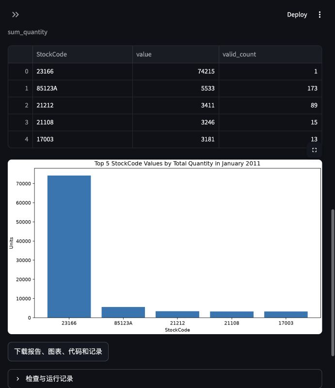

# 历史开发首页存档

以下内容保存于2026-11-10，来自整理前的README。它记录开发过程，部分“当前”状态、
本机服务和源码包信息属于当时的快照。新成员请先阅读[项目首页](../README.md)及
[团队交接说明](TEAM_HANDOFF_ZH.md)。指向私有运行和评估材料的链接仅在原工作目录可用。

---

# Tabular Analysis Agent with Iterative Verification

按照 COMP7608B 已提交 proposal 开发的单表数据分析与可视化 Agent。
正式代码位于 `src/tabular_agent/`；之前的入门例子保留在 `tutorials/`。
简明开发状态与下一阶段事项见 [PROJECT_STATUS_ZH.md](../docs/PROJECT_STATUS_ZH.md)。
已准备 [英文报告初稿](../report/DRAFT.md)、[演示流程](../docs/DEMO_RUNBOOK_ZH.md) 和
[正式实验交接](../docs/EXPERIMENT_HANDOFF_ZH.md)；报告清楚区分开发证据与尚缺的正式结果。
当前候选选择及需要团队完成的工作见[开发交接](../docs/DEVELOPMENT_CUTOFF_ZH.md)。

当前界面（Retail 商品销量开发任务，验证与修正模式；独立参考答案和人工评分仍待复核）：



## 源码交接

可用`python3 scripts/package_project.py --output dist/my-source.zip`生成开发源码包，
用`--verify dist/my-source.zip`校验。包内`START_HERE.md`说明独立安装、运行和恢复数据的
步骤，文件清单附逐项SHA-256；默认排除模型缓存、完整数据、历史运行及私有参考／评分。
详见[源码包及独立解压验收](../docs/SOURCE_PACKAGE_ZH.md)。这是开发快照，正式实验仍待完成。

## 启动

需要 Python 3.12、uv、Ollama 和 Docker engine。项目目前在 Apple Silicon + Colima 上开发。

```bash
uv sync --extra dev
# 分别启动模型服务和容器服务；已运行时不必重复启动
ollama serve
colima start --profile tabular-agent --cpu 2 --memory 4 --disk 20 --vm-type vz
# 首次准备（本机模型和镜像已准备过）
ollama pull qwen3:8b
uv run tabular-agent build-executor
uv run tabular-agent doctor
# 浏览器界面
uv run streamlit run app.py --server.address 127.0.0.1
```

浏览器访问 http://127.0.0.1:8501 。上传 CSV，输入问题及必要的字段含义/统计口径。
系统返回报告、表格、图表和可下载的代码/运行记录。歧义问题会要求补充信息，修改问题后重新提交。
评估 runner 和 CLI 还支持一条预写回复：`--clarification-response 'Use score.'`。
它只在模型实际提问后提供，随后在同一次运行、同一预算内重新规划；没有回复或再次提问则停止。

`doctor` 与 `build-executor` 默认也读取 `config/development.json`，可用
`--config path/to/settings.json` 指定其他配置。自检检查配置的模型服务、已安装模型和
执行镜像；输出 `ready: true` 才返回退出码0，缺少依赖返回1。它不会加载模型或执行推理，
也不代表分析结果正确。可在演示前运行一次，避免分析开始后才发现缺少依赖。

本机先前下载的模型保存在 `.cache/ollama-review-runtime/`。若默认模型目录没有
`qwen3:8b`，可在项目目录用下面的命令启动服务以复用现有模型，然后运行自检：

```bash
OLLAMA_MODELS="$PWD/.cache/ollama-review-runtime" ollama serve
# 另一终端
uv run tabular-agent doctor
```

命令行示例：

```bash
uv run tabular-agent run data/uci/bike/data.csv \
  'Plot mean cnt by hr as a line chart, hours ascending.' \
  --docs data/uci/bike/documentation.txt
```

## 已实现的工作流

```text
profile → plan → generate Python → execute in Docker → render → draft report → verify
            ↑                           ↑                                      │
            └── semantic/plan repair ────┴──── code repair ←─────────────────────┘
```

- CSV 类型、缺失率、样例、统计摘要和 SHA-256；保留输入快照。
- Qwen3 经 ChatOllama 生成结构化计划、pandas/NumPy 代码及最多三个有依据的报告发现。
- 单表 sum/mean/count/rows/missing/ratio、分组、数值/日期转换、筛选和派生字段；相关分析与原始值探索。
- Matplotlib 柱状图、折线图、散点图、直方图；保存实际绘图 artist 的数组、标签和来源。
- 从原始 CSV 独立重算支持的聚合，核对表格、有效计数、顺序、图表数据和报告引用。
- 从原始 CSV 独立重算非分组 Pearson 相关系数与成对有效计数；常量列及不足两对返回空系数。
- 计算不一致时反馈缺失分组及少量实际／预期单元格差异；执行阶段拒绝超出计划行数的结果。
- 对明确绑定单元格的最高／最低／范围陈述，与完整结果表核对；不明确的比较标为未覆盖。
- 对可识别的缺失率极值陈述，用各组缺失数／总数寻找反例；拒绝把缺失数量的图表标作缺失率。
- 单独调用同一个模型做语义审查。未覆盖的检查明确记录，不把它们视为通过。
- 验证步骤独立统计各条筛选和缺失处理影响的行数；审查同时看到实际报告文本和引用来源。
- 按实际报告动态生成审查 schema，每条发现与局限都是必填判断；遗漏、重复或无法判断会阻止整体语义通过。
- 最多 12 次工具调用（失败也计数）、最多 3 次修正、累计模型 token 预算；为重检保留调用数。
- 三个条件：`one_shot`、`no_verification`（仅执行错误恢复）、`full`（显式验证与修正）。
- 保存每个候选版本、错误、模型输入/结构化输出、token/耗时和内存测量范围。
- 按问题位置修正计划、代码、报告或检查；报告修正复用已有计算和图表，并记录来源。

执行接口为第三版：容器提供已经载入的 `df`、结构化 `plan`、预期输出列
`required_tables` 和原始数据类型 `column_types`；模型编写实际分析计算，最终赋值
`tables = {"分析ID": 结果DataFrame}`。容器负责统一导出 JSON；模型无需编写文件读写代码。
旧执行镜像会被拒绝，改动 worker 后需要重新运行 `tabular-agent build-executor`。

报告中的数值通过 `{{table.分析ID.行号.列名}}` 引用真实结果；问题里的年份和阈值使用
单独的 `request.numbers` 引用。已保存的筛选条件可用 `plan.filters.分析ID.筛选序号`
引用，用于说明处理范围，不能当作计算结果或数据实际覆盖范围。
`result.rows.分析ID` 引用实际保存结果表的行数，用于说明“前几个分组”等输出范围，
不能代表筛选后的原始记录数，也不直接使用计划中的数量上限。
直方图另从实际绘图artist提供`chart.ID.observations`、`chart.ID.bin_count`和
`chart.ID.bins.INDEX.count`（边界使用`lower`或`upper`）。每条发现仍需引用来源表。
绘图观察数不自动等于原始数据集大小。完整证据保存为`chart_evidence.json`。
预览为每行提供明确引用，避免模型自己数行号。
当前模型输出由文字片段和来源片段组成：模型自行选择内容、实际来源与支持表格，
程序按顺序拼接并插入数值引用。来源仅能选择预览单元格、完整表极值见证及已提供的
图表／常量引用；文字不能包含数字字符或花括号。生成规则覆盖当前Python运行时的
完整Unicode数字类别，并保留最终Python校验。英文数字词等语义仍需审查。
原始响应、片段结构与规范引用稿分别保存，三个条件共用相同适配器。
历史／本地规范稿仍支持原有grounding转换：无歧义数值及数字分组标签可绑定到已引用
单元格，用户／筛选常量只允许精确匹配。整数要求精确一致，小数允许按显示精度舍入；
歧义匹配会拒绝。转换记录与最终引用稿保存，不自动猜选来源。
渲染稿中仍不允许无依据的数字。引用不能证明类别含义、排名或解释正确，因此仍需
语义审查和人工评分。日期范围检查只覆盖明确的单个英文月份加年份请求。
报告预览还提供从完整结果表计算出的极值及引用位置，所有实验条件使用相同预览。
只有 `full` 条件执行额外的比较检查。当前检查覆盖部分明确的中英文极值／范围句式，
名次比较、并列比较、否定、条件句、唯一性、趋势、一般比例及类别含义仍需要语义审查。
缺失率检查仅覆盖部分中英文句式及明确的图表单位冲突；没有找到反例也不能证明排名或总体范围正确。

生成代码仅在 Docker 中运行：禁网、只读输入和根文件系统、非 root、限制内存/CPU/PID、
执行超时。没有普通 subprocess 执行生成代码的降级路径。模型与绘图在宿主机运行。
这是本地单用户研究应用。完整数值raw表及无歧义排序子集可从CSV独立核对，保留重复
次数和散点配对。任意抽样、含糊的limit边界、非数值raw及大型不确定近似匹配仍未覆盖；
相同投影值不能证明源行身份。图表可读性和解释质量仍需人工判断。
相关系数验证覆盖声明筛选后的非分组 Pearson，不支持分组／加权相关，也不能证明因果或计划选列正确。

结果位于 `runs/<run-id>/`：

```text
manifest.json / profile.json / trace.json / resources.json / summary.json / report.md
source/*.py
attempt-00/plan.json / analysis.py / execution.json / verification.json
attempt-00/candidate_draft.json / grounding.json / draft.json / report.md
attempt-00/tables/*.csv / charts/*.png / charts/metadata.json
```

`checks_passed` 表示适用程序检查与模型审查未发现问题，不能证明分析一定正确。
模型审查可能漏错或引入有害修正。被测 Agent 永远看不到评估参考答案。
每次运行保存实际载入的包源码及哈希；修改源码后应重启 Streamlit/运行进程再分析，
系统会拒绝继续使用修改前已导入的代码。

## 数据与开发评估

```bash
uv run python scripts/download_data.py bike adult retail
uv run python evaluation/build_references.py
uv run python evaluation/run.py --ids D3 D5 --conditions full --repeats 1 \
  --output evaluation/runs/my-pilot
# 对保存的开发报告做额外诊断，不更改原有结果或评分
uv run python evaluation/audit_report_comparisons.py \
  --root evaluation/runs/pilot-statement-review \
  --output evaluation/private/report-comparison-audit-v1.json
```

新实验批次使用新的输出目录，自动保存 `cohort.json`。进程中断后，同一命令添加
`--resume` 可保留已终止的成功、失败和用量，只运行尚未开始的任务格；日志应以 `>>`
追加。源码、配置、数据、参考或环境变化会拒绝续跑，进行到一半的调用保留待审计，
不会自动重试。完整示例见 [评估流程](../evaluation/README.md#resuming-a-fixed-cohort)。

数据来源与许可保存在 `data/uci/<dataset>/metadata.json`，三个来源均为 UCI / CC BY 4.0：
Online Retail（Daqing Chen）、Bike Sharing（Hadi Fanaee-T）、Adult（Barry Becker、Ronny Kohavi）。
原始下载文件、CSV 哈希、字段说明与预处理记录一起保存。

六项开发任务在 `evaluation/tasks.json`；独立参考答案在忽略提交的 `evaluation/private/`。
评估脚本不会将答案送入模型，也不会挂载到执行容器。
可供队友复核的任务、公式及完整参考表索引已准备在
`evaluation/private/reference-review-v1/INDEX.md`，其中的复核栏仍留空。

界面和 CLI 都从 `config/development.json` 读取默认配置；界面可以覆盖模型名和运行模式。
当前开发默认使用 6,144 输出 token，规划／代码／报告不启用 thinking，语义审查启用 thinking。
下述v15比较另用代码／审查thinking的候选配置，默认配置未改变；**尚未正式冻结，也不能视为最优配置**。
30 项 held-out 任务和 12 个鲁棒性变体已有草稿及参考计算，尚未运行被测 Agent。
任务家族划分和答案需要独立复核；正式评估和双人盲评尚未完成。
当前585项测试（含真实Docker）及Ruff通过，原型仍有生成与审查可靠性问题。
[v23空值排序](../docs/DEV_NULL_SORT_V23_ZH.md)和[v24缺失标记](../docs/DEV_MISSING_MARKERS_V24_ZH.md)
修复独立复算与worker的确定性差异；v25新增源码打包及独立解压环境验收，未增加模型成绩。
[v21报告接口](../docs/DEV_DRAFT_PARTS_V21_ZH.md)已接入文字／来源片段；一次完整Chrome
直方图流程内部通过检查，59条ZIP内容匹配。另一次D1报告诊断仍因Unicode数字字符
失败，历史记录和全部成本保留。[v22规则修复](../docs/DEV_UNICODE_PROSE_V22_ZH.md)已将
生成规则与最终数字字符校验对齐；一次报告诊断绑定通过，文字仍笼统，未做整题评价。
[v20原始观测检查](../docs/DEV_RAW_OBSERVATIONS_V20_ZH.md)补齐完整数值raw表和明确
排序子集的CSV核对。正确绘图仍可能使用错误观测值；相同分箱计数的错值反例现能检出。
本轮不新增模型推理，不改写历史失败或完整比较成绩。
[v19直方图证据](../docs/DEV_HISTOGRAM_EVIDENCE_V19_ZH.md)补齐实际分箱值到报告／审查
的传递。一次Chrome上传、计算、候选显示和ZIP下载已完成；模型读到正确箱计数，
报告仍因未绑定边界数值失败。14,105token和全部失败记录单独保留。
后续[v18图表接口验证](../docs/DEV_CHART_TYPES_V18_ZH.md)修复了规划时省略纵轴字段的
解码问题，并澄清直方图原始输入合同。真实直方图数据和分箱正确，但完整报告失败；
散点图最终计划正确，代码仍截断。全部六次失败及成本保留，不改变下面的完整v15成绩。
最近完整v15六任务、三条件、共18次开发比较已完成，见
[当前三条件开发对比](../docs/DEV_COMPARISON_V15_ZH.md)：明确题数值匹配1/2、2/2、2/2；
图表题0/2、1/2、0/2。按四个明确／图表题的最终保留结果为1/4、3/4、2/4；
full没有显示整体数值优势。D1一次生成和D3/full曾算出匹配表格，但分别因报告和审查
失败没有最终所选报告；不能把这些都叫作错误计算。D6/full检出漏答并重规划，新代码
执行成功，但仍有计数／排序／解释问题，最终failed，保留旧的覆盖失败候选。
全部运行共6,845.4秒、437,528token，包含失败；1,043原始文件已核对。模型进程RSS
不可用，不补零。当前源码在开跑前397项测试（含真实Docker）及Ruff通过；测试不等于
模型任务质量。参考复核和人工整题评分仍未完成。
历史[v12完整比较](../docs/DEV_COMPARISON_V12_ZH.md)保持原样：明确题50%／100%／100%，
图表题100%／50%／50%。不同实现及环境不合并，也不把版本差异归因于某个补丁。
v12结束后已应用具体引用格式错误反馈；D2／D6两项定向复测已完成，单独保存。
D6实际按反馈修复报告引用，但仍缺少类别差异分析；D2首次成功，未触发新反馈。
详见 [v13定向验证](../docs/DEV_REFERENCE_FEEDBACK_V13_ZH.md)。
后续新增必填的请求覆盖判断，针对漏掉用户要求的分析／回答给出修正目标；同一保存报告
对照中D6遗漏被新审查检出，D2仍通过。单独D6完整流程实际触发重规划，最后代码生成
达到输出上限，仍记为失败。详见 [v14请求覆盖验证](../docs/DEV_REQUEST_COVERAGE_V14_ZH.md)。
随后修复重规划后的过时上下文：新计划重新生成代码与计算，同计划代码修正仍保留相关
错误与结果，报告修正仍复用执行。原始失败保留，见[v15开发验证](../docs/DEV_PLAN_CONTEXT_V15_ZH.md)。
较早的固定代码阶段对照仍判不合格；随后完成的v15整轮比较单独保存，不替换该对照。
完整v15结束后，v16将覆盖判断的修正建议设为解码必填，与原有失败校验一致。
四次固定保存案例审查中，D3由解析失败变为整体uncovered，D5两版均pass；这不是D3
整题恢复。全部41,612token和失败保留，见[v16接口验证](../docs/DEV_REQUEST_ACTION_V16_ZH.md)。
v16未运行新的完整三条件比较；上面的v15成绩保持原样。
随后已完成当前源码的一次真实Chrome上传→推理→结果→ZIP下载：D5/default/full运行
236.2秒、41,079token、一次报告修正；79文件逐项匹配，数值表匹配未复核参考。
同一句缺失值局限在两次审查中由fail变pass，解释质量仍有限制，见
[v16浏览器验收](../docs/DEV_BROWSER_V16_ZH.md)。本次与v15配置不同，不合并成绩。
当前v17让复查看到先前失败的具体语句及原文匹配，重算／重规划时清理历史，并修复
报告反馈混入后续格式重试的问题。六次审查诊断中的两次格式失败完整保留；单次完整
D5流程数值匹配，但首次审查放过原说明，未触发新修正路径，不能宣称真实恢复。
实现、413项测试和全部成本见[v17复查上下文](../docs/DEV_REPORT_REVISION_V17_ZH.md)。
逐条审查的必填结构已解决漏项，但真实模型仍放过部分错误解释，也曾建议有害修正。
后续定向 v10 在代码阶段启用 thinking：D1 数值匹配未复核参考，D6 数值表通过声明计划的
重算，但报告错误声称 White 的缺失率最高，语义审查漏检。随后新增的缺失率检查能在保存
结果中检出具体反例；这不是重跑或新的整题成功率。详见
[后续开发证据](../docs/DEV_FOLLOWUP_V10_V11_ZH.md)。默认配置仍只在审查阶段启用 thinking。
已完成的 `pilot-report-contract-v4` 六任务试跑中，D1/D3/D5 的自动检查通过，
数值表匹配未复核参考；D2/D4/D6 失败。后续三任务 `pilot-representation-v5` 中，
D2 实际修正报告并通过检查，D4/D6 仍失败。它们使用不同版本，不能合并为准确率。
`pilot-runtime-contract-v6` 已完成六任务：D2/D5 自动检查通过，D1/D3/D4/D6 失败。
其中 D1 的无关字段缺失删除导致少组和少算，独立重算正确检出；D4 计划十行却输出
二十四行，报告的 top10 说法被拒绝。最新代码增加具体计算差异反馈及输出行数上限检查，
定向复测 `pilot-diagnostics-limit-v7` 已完成：D1仍失败，D4在行数超限报错后实际修正代码并
通过自动检查。它不是新六任务成绩，也不代表探索结论已经人工验证。历史结果保持原样。
失败界面可展开查看明确标注为未通过完整检查的候选表格与图表；原始结果和错误记录完整保留。
`config/pilot-thinking.json` 与 `config/pilot-review-thinking-v2.json` 是不同推理策略的开发配置，
开发默认已与 review-only thinking 配置对齐，正式配置仍未冻结。这些案例不构成正式性能结论。
详见 `evaluation/README.md` 与 `docs/IMPLEMENTATION.md`。

## 检查

```bash
uv run pytest -q
# 真实容器测试需要能访问 Docker socket；Colima 的临时目录需位于已挂载的项目内
TABULAR_DOCKER_TESTS=1 uv run pytest -q --basetemp .cache/pytest-docker
uv run ruff check src app.py tests scripts evaluation docker
```

容器测试实际验证禁网、输入/根目录只读、超时停止，以及拒绝符号链接和特殊文件。
控制器测试覆盖验证后修正、失败调用计费、次数/预算耗尽、三种实验条件。

## 边界与开发状态

不支持多表连接、预测模型或因果推断。CSV 使用 pandas 默认 NA 规则并补充 `?`，
文本去除首尾空白；这些处理会显示在 profile 中。日期混合格式只应在含义明确时转换。
分组／加权相关、任意raw抽样、含糊截断及不受支持的近似匹配仍标为独立计算检查未覆盖。
完整数值观测、重复次数和散点配对已有CSV检查；图表可读性和探索结论需要人工评分。
程序验证只能证明计算与声明的计划一致，不能证明计划选对了问题。

最终提交稿是 `proposal/Formatting_Instructions_For_NeurIPS_2026.pdf`，文件名沿用了格式说明名称。
