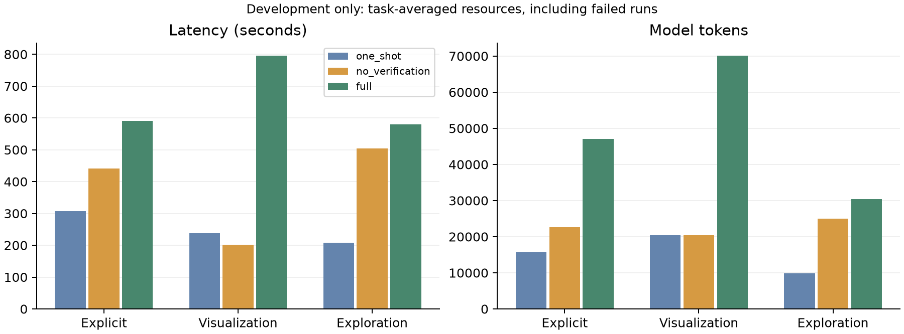

# 三条件开发对比

2026-11-15本地基线，使用本批次归档的修复前源码；应用默认配置的浏览器小例另记于文末。

完整覆盖 6 个开发任务、三个条件、每条件 1 次运行，共 18 次。
数值匹配来自保存的外部参考比较；本报告不证明参考已独立复核，也没有人工整题评分。
自动检查通过、执行成功、数值表匹配和报告可用性分别呈现。探索质量仍需两位人工评分者。
按最终所选候选比较；没有所选报告时的未匹配，不代表此前执行的所有表格都算错。

| 任务／类别 | 一次生成 | 仅执行错误恢复 | 验证与修正 |
| --- | --- | --- | --- |
| D1 / 明确问题 | r0: 报告已生成（未验证）；数值表匹配参考 | r0: 失败（无报告）；数值表未匹配参考 | r0: 自动检查通过；数值表匹配参考 |
| D2 / 指定图表 | r0: 报告已生成（未验证）；数值表匹配参考 | r0: 报告已生成（未验证）；数值表匹配参考 | r0: 失败（保留候选报告）；数值表匹配参考 |
| D3 / 指定图表 | r0: 报告已生成（未验证）；数值表匹配参考 | r0: 报告已生成（未验证）；数值表匹配参考 | r0: 失败（保留候选报告）；数值表匹配参考 |
| D4 / 开放探索 | r0: 失败（无报告） | r0: 报告已生成（未验证） | r0: 自动检查通过 |
| D5 / 明确问题 | r0: 失败（无报告）；数值表未匹配参考 | r0: 报告已生成（未验证）；数值表匹配参考 | r0: 自动检查通过；数值表匹配参考 |
| D6 / 开放探索 | r0: 失败（无报告） | r0: 失败（无报告） | r0: 失败（无报告） |

## 分类别的数值与执行结果

百分比先在每个任务内平均重复运行，再对任务等权平均；人工整题通过率尚不可用。
报告可用表示保留了所选候选报告，即使状态仍为失败。探索不提供自动整题正确率。

| 类别 | 条件 | 任务数 | 曾成功执行 | 保留报告 | 数值表匹配参考 | 图表数据和类型符合 |
| --- | --- | ---: | ---: | ---: | ---: | ---: |
| 明确问题 | 一次生成 | 2 | 50% | 50% | 50% | — |
| 明确问题 | 仅执行错误恢复 | 2 | 50% | 50% | 50% | — |
| 明确问题 | 验证与修正 | 2 | 100% | 100% | 100% | — |
| 指定图表 | 一次生成 | 2 | 100% | 100% | 100% | 100% |
| 指定图表 | 仅执行错误恢复 | 2 | 100% | 100% | 100% | 100% |
| 指定图表 | 验证与修正 | 2 | 100% | 100% | 100% | 100% |
| 开放探索 | 一次生成 | 2 | 0% | 0% | 待人工评分 | — |
| 开放探索 | 仅执行错误恢复 | 2 | 50% | 50% | 待人工评分 | — |
| 开放探索 | 验证与修正 | 2 | 50% | 50% | 待人工评分 | — |

## 阶段异常与输出截断

下表是本轮实际次数与开销总和，包含后来修复的异常，不是任务等权均值或最终失败归因。
节点异常来自 trace 的 node_error；模型调用失败与节点异常可能重叠，不相加。
模型成功返回后，报告仍可能因引用绑定失败；验证发现的问题也不一定抛出节点异常。
截断 token 包含该调用的输入及输出，秒为客户端调用墙钟时间；任一截断调用缺测则总量为 —。

token 按 trace 的用量计费记录累计；没有实际用量时，保留其预留扣账，不能当作实测用量。

| 条件 | 阶段 | 节点异常 | 模型调用 | 调用失败 | 输出截断 | 截断秒（测量数） | 截断 token（计费数） |
| --- | --- | ---: | ---: | ---: | ---: | ---: | ---: |
| 一次生成 | 规划 | 1 | 6 | 0 | 0 | 0.0 (0/0) | 0 (0/0) |
| 一次生成 | 代码生成 | 2 | 5 | 2 | 2 | 686.3 (2/2) | 16,003 (2/2) |
| 一次生成 | 报告引用与生成 | 0 | 3 | 0 | 0 | 0.0 (0/0) | 0 (0/0) |
| 仅执行错误恢复 | 规划 | 1 | 7 | 0 | 0 | 0.0 (0/0) | 0 (0/0) |
| 仅执行错误恢复 | 代码生成 | 3 | 10 | 3 | 3 | 1,024.3 (3/3) | 24,074 (3/3) |
| 仅执行错误恢复 | 容器执行 | 3 | 0 | 0 | 0 | 0.0 (0/0) | 0 (0/0) |
| 仅执行错误恢复 | 报告引用与生成 | 0 | 4 | 0 | 0 | 0.0 (0/0) | 0 (0/0) |
| 验证与修正 | 规划 | 1 | 10 | 0 | 0 | 0.0 (0/0) | 0 (0/0) |
| 验证与修正 | 代码生成 | 3 | 11 | 3 | 3 | 1,113.4 (3/3) | 24,074 (3/3) |
| 验证与修正 | 报告引用与生成 | 1 | 7 | 0 | 0 | 0.0 (0/0) | 0 (0/0) |
| 验证与修正 | 验证 | 1 | 10 | 1 | 0 | 0.0 (0/0) | 0 (0/0) |

## 资源开销

所有运行均计入，包括失败、澄清及探索。下表为任务等权均值。工具失败也消耗调用，审查消耗计入 token。
内存分别测量 worker RSS、控制器 RSS 和可见 Ollama 进程 RSS；不包含 Metal 分配与 Docker VM。
worker 内存括号为有测量的运行数／该组总运行数；不可用记为 —，不补零。

| 类别 | 条件 | 秒 | token | 工具调用 | 修正 | worker MiB（测量数） | 控制器 MiB | Ollama MiB |
| --- | --- | ---: | ---: | ---: | ---: | ---: | ---: | ---: |
| 明确问题 | 一次生成 | 307.1 | 15,734 | 2.0 | 0.0 | 237.3 (1/2) | 271.5 | 8,662.5 |
| 明确问题 | 仅执行错误恢复 | 440.6 | 22,563 | 3.5 | 1.5 | 93.3 (1/2) | 240.8 | 9,058.2 |
| 明确问题 | 验证与修正 | 590.5 | 47,022 | 5.5 | 1.0 | 179.8 (2/2) | 361.2 | 9,639.0 |
| 指定图表 | 一次生成 | 238.6 | 20,387 | 3.0 | 0.0 | 151.3 (2/2) | 351.6 | 10,172.4 |
| 指定图表 | 仅执行错误恢复 | 201.7 | 20,340 | 3.0 | 0.0 | 151.3 (2/2) | 231.4 | 9,764.4 |
| 指定图表 | 验证与修正 | 796.0 | 70,134 | 8.0 | 2.5 | 152.7 (2/2) | 342.3 | 10,255.6 |
| 开放探索 | 一次生成 | 208.2 | 9,856 | 1.0 | 0.0 | — (0/2) | 136.2 | 9,058.1 |
| 开放探索 | 仅执行错误恢复 | 503.5 | 25,050 | 2.0 | 1.0 | 78.9 (1/2) | 117.8 | 8,812.7 |
| 开放探索 | 验证与修正 | 579.0 | 30,434 | 2.5 | 1.0 | 78.9 (1/2) | 118.5 | 8,804.7 |

模型载入与推理另计：载入取服务端 `load_duration`；推理取 `prompt_eval_duration + eval_duration`。
载入指标是本轮各次调用报告的开销；本轮未安排冷启动实验，不能据此推断冷启动性能。
调用墙钟时间还包含网络、序列化及客户端开销，不将其直接称为纯推理时间。
某次运行任一调用缺少该项计时，则该运行不进入该项均值；括号为完整测量的运行数／该组总运行数。

| 类别 | 条件 | 模型载入秒 | 服务端推理秒 | 客户端模型调用秒 | 服务端计时覆盖（载入／推理／调用总数） |
| --- | --- | ---: | ---: | ---: | ---: |
| 明确问题 | 一次生成 | 0.006 (2/2) | 302.8 (2/2) | 306.0 (2/2) | 5/5/5 |
| 明确问题 | 仅执行错误恢复 | 0.016 (2/2) | 437.0 (2/2) | 438.0 (2/2) | 8/8/8 |
| 明确问题 | 验证与修正 | 0.025 (2/2) | 582.6 (2/2) | 585.0 (2/2) | 13/13/13 |
| 指定图表 | 一次生成 | 0.011 (2/2) | 236.3 (2/2) | 237.3 (2/2) | 6/6/6 |
| 指定图表 | 仅执行错误恢复 | 0.012 (2/2) | 199.2 (2/2) | 200.4 (2/2) | 6/6/6 |
| 指定图表 | 验证与修正 | 0.029 (2/2) | 784.0 (2/2) | 789.3 (2/2) | 17/17/17 |
| 开放探索 | 一次生成 | 0.003 (2/2) | 205.1 (2/2) | 208.0 (2/2) | 3/3/3 |
| 开放探索 | 仅执行错误恢复 | 0.012 (2/2) | 501.2 (2/2) | 503.0 (2/2) | 7/7/7 |
| 开放探索 | 验证与修正 | 0.013 (2/2) | 575.3 (2/2) | 578.5 (2/2) | 8/8/8 |

## 可追溯性与限制

- 实现／环境 fingerprint：`c316028ddb274463a7cac7da0a78af984b22077cd2bdb38f18e1463a7cb3b644`。
- 配置 SHA-256：`2aaf0e7ec9915e978b09d7afbe0a05fc82e004de995fc636bf468099ba4b1f70`；任务 SHA-256：`045482ab62dca46bd5f363467c190eb971cf636f397e5949bbdc59fbb88ec9a2`。
- 保存的包源码、runner、输入 CSV 哈希已核对；有效配置除条件及重复 seed 外一致。
- 这是开发任务上的小样本对比；运行按任务及条件顺序执行，没有随机化运行顺序。
- 数值匹配不验证字段解释、问题覆盖、图表可读性或探索用途；同模型审查也可能漏错或引入错误。
- 未提供 held-out 结论、人工正确率或验证效益的正式因果结论。

原始记录（保持原样）：

- [D1 / one_shot / r0](../../evaluation/runs/local-dev-20261115/20261115-170706-c2496fa4/evaluation.json)
- [D1 / no_verification / r0](../../evaluation/runs/local-dev-20261115/20261115-171111-f07f28b6/evaluation.json)
- [D1 / full / r0](../../evaluation/runs/local-dev-20261115/20261115-171727-1d7e0427/evaluation.json)
- [D2 / one_shot / r0](../../evaluation/runs/local-dev-20261115/20261115-172805-7cfcfc9a/evaluation.json)
- [D2 / no_verification / r0](../../evaluation/runs/local-dev-20261115/20261115-173116-afe9c730/evaluation.json)
- [D2 / full / r0](../../evaluation/runs/local-dev-20261115/20261115-173409-f0c6a55f/evaluation.json)
- [D3 / one_shot / r0](../../evaluation/runs/local-dev-20261115/20261115-174304-d7655938/evaluation.json)
- [D3 / no_verification / r0](../../evaluation/runs/local-dev-20261115/20261115-174751-a540fe71/evaluation.json)
- [D3 / full / r0](../../evaluation/runs/local-dev-20261115/20261115-175142-9a9f2241/evaluation.json)
- [D4 / one_shot / r0](../../evaluation/runs/local-dev-20261115/20261115-180920-c13a172c/evaluation.json)
- [D4 / no_verification / r0](../../evaluation/runs/local-dev-20261115/20261115-180954-f92a286f/evaluation.json)
- [D4 / full / r0](../../evaluation/runs/local-dev-20261115/20261115-181430-8ee6d7c1/evaluation.json)
- [D5 / one_shot / r0](../../evaluation/runs/local-dev-20261115/20261115-181959-84e7ca69/evaluation.json)
- [D5 / no_verification / r0](../../evaluation/runs/local-dev-20261115/20261115-182608-cf6bf04f/evaluation.json)
- [D5 / full / r0](../../evaluation/runs/local-dev-20261115/20261115-183434-e43e0e17/evaluation.json)
- [D6 / one_shot / r0](../../evaluation/runs/local-dev-20261115/20261115-184337-365a2372/evaluation.json)
- [D6 / no_verification / r0](../../evaluation/runs/local-dev-20261115/20261115-185000-583ab355/evaluation.json)
- [D6 / full / r0](../../evaluation/runs/local-dev-20261115/20261115-190212-48b982f8/evaluation.json)

## 本轮结论与具体失败

18格全部终止，runner退出码为0，表示批次执行完成。系统状态为：一次生成3次未验证交付、
3次失败；仅错误恢复4次未验证交付、2次失败；full 3次checks_passed、2次failed、
1次budget_exhausted。失败状态的D2/full和D3/full仍保留候选报告，不能算作正常完成。

| 最终所选数值匹配 | 一次生成 | 仅错误恢复 | full |
| --- | ---: | ---: | ---: |
| 明确问题（2题） | 1/2 | 1/2 | 2/2 |
| 指定图表（2题） | 2/2 | 2/2 | 2/2 |
| 合计（4题） | 3/4 | 3/4 | 4/4 |

这些是开发参考的数值匹配；探索用途、语义、完整回答及可读性没有人工整题分数。
full的所选数值匹配更多，同时耗时更高且两个图表流程未正常结束。这一小样本不能证明
验证整体有效，也不能把失败后保留的正确表格当作成功交付。

- **D1有真实修正，也有生成失败。** full初始计划漏掉一月日期范围，核验指出遗漏后
  重规划并加入上下界，最终数值匹配且内部通过。仅错误恢复则经历缩进错误与字面量
  `\n`语法错误，三次执行均失败。最终full报告仍多用“saved value”之类笼统描述。
- **D2数值正确，语义与审查仍有问题。** 一次生成的表格与图表正确，但报告把商品代码
  23166接在January之后；来源绑定通过不保证文字含义正确。full也保留正确数值和图表，
  却经历排名审查争议及statement verdict放错字段的格式异常，最终failed。
- **D3出现审查追加要求。** 原题要求小时均值折线图并提供有效计数，没有明确要求
  两条曲线同图或逐一叙述全部小时。审查却把两项当成硬要求，触发两次重规划；当前
  chart接口只声明一个y字段。最终耗时1,057.5秒、88,575 token并预算耗尽，仍保留匹配
  参考的数值候选。这是开发者事后检查，不改写原来的失败判断。
- **D4内部通过仍不足以证明探索有用。** 一次生成的raw＋group_by计划不合法；两个
  恢复条件修正为小时均值、季节均值、temp与atemp相关。小时表只取升序前10小时，
  天气相关也没有包含需求cnt；最终报告主要列出孤立小时／季节值。full内部放行，
  仍有覆盖和用途局限，尚未按人工rubric评分。
- **D5能从截断恢复。** 三条件初始代码调用均达到输出上限。两个恢复条件随后生成
  简短完整代码，工时均值及有效计数匹配；full内部通过。一次生成没有进入执行。
- **D6没有进入执行。** 三条件初始计划均只有workclass、occupation、native-country
  的总体缺失数，缺少题目要求的类别差异。代码初始生成均截断，两个恢复条件各再截断
  一次后停止，没有进入语义核验，不能声称这一轮full发现或修复了该遗漏。

全部18次合计7,730.4运行秒（128.8分钟）、523,041模型token，失败均计入。8次代码
截断占2,824.0客户端秒、64,151输入及输出token，是总成本的子集。保存响应显示这8次
代码正文均为空，6,144输出token用于thinking；不是生成了6,144 token的Python再截断。
同一配置也会因缓存和运行时负载出现不同耗时，本轮顺序固定，不能据此作独立的延迟因果比较。

## 本地界面小例：失败保留

在18次比较前，通过真实浏览器上传六行`data/tutorial_rentals.csv`，固定询问rentals
总和、有效计数及按weather汇总的柱状图。人工可核算预期为总和152、有效计数6。
采用应用默认`config/development.json`，与上述代码／审查thinking候选分别记录。

运行[20261115-170417-10ed83bf](../../runs/20261115-170417-10ed83bf/summary.json)
最终failed，86.5秒、8,385 token、一次修正。两版代码在groupby链中含相同的字面量
`\n`，两次Docker执行均语法失败，未产生分析报告。界面显示失败并实际下载ZIP，49个
导出条目逐项匹配运行文件、原CSV未导出。这验证了失败显示与下载，成功分析验收仍未完成。

## 验证回执与下一步

本轮所有1,127个运行文件与cohort登记哈希一致，源码／配置／数据／参考保持一致，
终止状态及模型／工具账目核对通过；原有10,784个文件逐项哈希未变。开发数值参考另外
用CSV逐行计算、整数计数和Decimal金额复算，四题均匹配；这属于工具辅助自查，
不构成独立人工复核。没有新增人工评分或held-out推理。

- [完整核对回执](../../.cache/local-baseline-20261115/final-validation.json)
- [开发参考自查](../../.cache/local-baseline-20261115/development-reference-self-check.json)
- [定性观察记录](../../.cache/local-baseline-20261115/quality-observations.json)
- [浏览器回执](../../.cache/local-baseline-20261115/smoke-receipt.json)
- [机器可读汇总](../../report/archive/development-evidence-local-20261115.json)

按本轮各类别／条件两题均值，外推42题×三条件×两次重复的252次运行约30.3小时、
7,642,222 token，仅为排期估计，不含人工复核、评分、中断及打包，也不是held-out实测。
旧v15约23.5小时的估计保留为历史数据，不与本轮混合。

本轮暴露的后续工作包括代码生成长度／语法、审查对原题要求的约束、报告含义与覆盖。
后续修复保留本轮全部失败，另行记录验证证据。本批次运行期间未修改源码、配置、
参考复核标志或人工分数。当前进度与排期见[本地完成计划](../LOCAL_COMPLETION_PLAN_ZH.md)。
