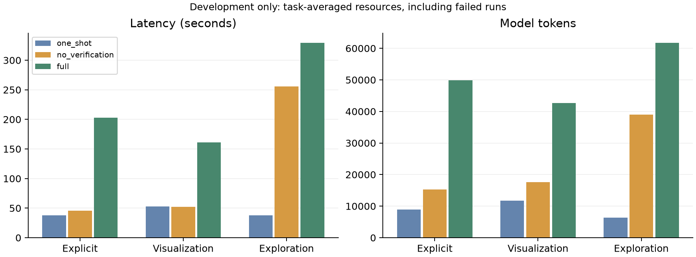

# 三条件开发对比

完整覆盖 6 个开发任务、三个条件、每条件 1 次运行，共 18 次。
数值匹配来自保存的外部参考比较；本报告不证明参考已独立复核，也没有人工整题评分。
自动检查通过、执行成功、数值表匹配和报告可用性分别呈现。探索质量仍需两位人工评分者。

| 任务／类别 | 一次生成 | 仅执行错误恢复 | 验证与修正 |
| --- | --- | --- | --- |
| D1 / 明确问题 | r0: 失败（无报告）；数值表未匹配参考 | r0: 报告已生成（未验证）；数值表未匹配参考 | r0: 自动检查通过；数值表匹配参考 |
| D2 / 指定图表 | r0: 失败（无报告）；数值表未匹配参考 | r0: 报告已生成（未验证）；数值表未匹配参考 | r0: 失败（无报告）；数值表未匹配参考 |
| D3 / 指定图表 | r0: 报告已生成（未验证）；数值表匹配参考 | r0: 报告已生成（未验证）；数值表匹配参考 | r0: 自动检查通过；数值表匹配参考 |
| D4 / 开放探索 | r0: 失败（无报告） | r0: 报告已生成（未验证） | r0: 失败（保留候选报告） |
| D5 / 明确问题 | r0: 报告已生成（未验证）；数值表匹配参考 | r0: 报告已生成（未验证）；数值表匹配参考 | r0: 自动检查通过；数值表匹配参考 |
| D6 / 开放探索 | r0: 失败（无报告） | r0: 报告已生成（未验证） | r0: 失败（保留候选报告） |

## 分类别的数值与执行结果

百分比先在每个任务内平均重复运行，再对任务等权平均；人工整题通过率尚不可用。
报告可用表示保留了所选候选报告，即使状态仍为失败。探索不提供自动整题正确率。

| 类别 | 条件 | 任务数 | 曾成功执行 | 保留报告 | 数值表匹配参考 | 图表数据和类型符合 |
| --- | --- | ---: | ---: | ---: | ---: | ---: |
| 明确问题 | 一次生成 | 2 | 50% | 50% | 50% | — |
| 明确问题 | 仅执行错误恢复 | 2 | 100% | 100% | 50% | — |
| 明确问题 | 验证与修正 | 2 | 100% | 100% | 100% | — |
| 指定图表 | 一次生成 | 2 | 50% | 50% | 50% | 50% |
| 指定图表 | 仅执行错误恢复 | 2 | 100% | 100% | 50% | 50% |
| 指定图表 | 验证与修正 | 2 | 100% | 50% | 50% | 50% |
| 开放探索 | 一次生成 | 2 | 0% | 0% | 待人工评分 | — |
| 开放探索 | 仅执行错误恢复 | 2 | 100% | 100% | 待人工评分 | — |
| 开放探索 | 验证与修正 | 2 | 100% | 100% | 待人工评分 | — |

## 阶段异常与输出截断

下表是本轮实际次数与开销总和，包含后来修复的异常，不是任务等权均值或最终失败归因。
节点异常来自 trace 的 node_error；模型调用失败与节点异常可能重叠，不相加。
模型成功返回后，报告仍可能因引用绑定失败；验证发现的问题也不一定抛出节点异常。
截断 token 包含该调用的输入及输出，秒为客户端调用墙钟时间；任一截断调用缺测则总量为 —。

token 按 trace 的用量计费记录累计；没有实际用量时，保留其预留扣账，不能当作实测用量。

| 条件 | 阶段 | 节点异常 | 模型调用 | 调用失败 | 输出截断 | 截断秒（测量数） | 截断 token（计费数） |
| --- | --- | ---: | ---: | ---: | ---: | ---: | ---: |
| 一次生成 | 规划 | 4 | 6 | 0 | 0 | 0.0 (0/0) | 0 (0/0) |
| 一次生成 | 代码生成 | 0 | 2 | 0 | 0 | 0.0 (0/0) | 0 (0/0) |
| 一次生成 | 报告引用与生成 | 0 | 2 | 0 | 0 | 0.0 (0/0) | 0 (0/0) |
| 仅执行错误恢复 | 规划 | 4 | 10 | 0 | 0 | 0.0 (0/0) | 0 (0/0) |
| 仅执行错误恢复 | 代码生成 | 0 | 6 | 0 | 0 | 0.0 (0/0) | 0 (0/0) |
| 仅执行错误恢复 | 报告引用与生成 | 2 | 8 | 2 | 1 | 315.1 (1/1) | 14,652 (1/1) |
| 验证与修正 | 规划 | 4 | 15 | 0 | 0 | 0.0 (0/0) | 0 (0/0) |
| 验证与修正 | 代码生成 | 0 | 12 | 0 | 0 | 0.0 (0/0) | 0 (0/0) |
| 验证与修正 | 报告引用与生成 | 2 | 11 | 2 | 1 | 297.1 (1/1) | 14,652 (1/1) |
| 验证与修正 | 验证 | 2 | 9 | 1 | 0 | 0.0 (0/0) | 0 (0/0) |

## 资源开销

所有运行均计入，包括失败、澄清及探索。下表为任务等权均值。工具失败也消耗调用，审查消耗计入 token。
内存分别测量 worker RSS、控制器 RSS 和可见 Ollama 进程 RSS；不包含 Metal 分配与 Docker VM。
worker 内存括号为有测量的运行数／该组总运行数；不可用记为 —，不补零。

| 类别 | 条件 | 秒 | token | 工具调用 | 修正 | worker MiB（测量数） | 控制器 MiB | Ollama MiB |
| --- | --- | ---: | ---: | ---: | ---: | ---: | ---: | ---: |
| 明确问题 | 一次生成 | 38.1 | 8,907 | 1.5 | 0.0 | 93.3 (1/2) | 284.2 | 7,132.8 |
| 明确问题 | 仅执行错误恢复 | 45.8 | 15,226 | 2.0 | 0.5 | 194.1 (2/2) | 267.7 | 6,659.6 |
| 明确问题 | 验证与修正 | 203.1 | 49,896 | 6.0 | 2.5 | 194.8 (2/2) | 371.4 | 6,696.3 |
| 指定图表 | 一次生成 | 53.1 | 11,686 | 2.0 | 0.0 | 81.2 (1/2) | 299.8 | 6,400.3 |
| 指定图表 | 仅执行错误恢复 | 52.1 | 17,574 | 3.0 | 0.5 | 180.5 (2/2) | 252.7 | 6,671.3 |
| 指定图表 | 验证与修正 | 161.2 | 42,688 | 7.0 | 2.0 | 180.4 (2/2) | 363.4 | 6,904.8 |
| 开放探索 | 一次生成 | 37.9 | 6,404 | 1.0 | 0.0 | — (0/2) | 134.1 | 6,884.2 |
| 开放探索 | 仅执行错误恢复 | 255.5 | 38,936 | 3.0 | 2.0 | 94.1 (2/2) | 139.5 | 6,923.8 |
| 开放探索 | 验证与修正 | 329.6 | 61,761 | 5.5 | 2.5 | 94.1 (2/2) | 163.4 | 6,986.1 |

模型载入与推理另计：载入取服务端 `load_duration`；推理取 `prompt_eval_duration + eval_duration`。
载入指标是本轮各次调用报告的开销；本轮未安排冷启动实验，不能据此推断冷启动性能。
调用墙钟时间还包含网络、序列化及客户端开销，不将其直接称为纯推理时间。
某次运行任一调用缺少该项计时，则该运行不进入该项均值；括号为完整测量的运行数／该组总运行数。

| 类别 | 条件 | 模型载入秒 | 服务端推理秒 | 客户端模型调用秒 | 服务端计时覆盖（载入／推理／调用总数） |
| --- | --- | ---: | ---: | ---: | ---: |
| 明确问题 | 一次生成 | 0.011 (2/2) | 36.9 (2/2) | 37.4 (2/2) | 4/4/4 |
| 明确问题 | 仅执行错误恢复 | 0.017 (2/2) | 43.2 (2/2) | 44.2 (2/2) | 7/7/7 |
| 明确问题 | 验证与修正 | 0.047 (2/2) | 195.2 (2/2) | 196.9 (2/2) | 17/17/17 |
| 指定图表 | 一次生成 | 0.010 (2/2) | 52.2 (2/2) | 52.4 (2/2) | 4/4/4 |
| 指定图表 | 仅执行错误恢复 | 0.016 (2/2) | 50.3 (2/2) | 50.7 (2/2) | 7/7/7 |
| 指定图表 | 验证与修正 | 0.036 (2/2) | 152.7 (2/2) | 153.6 (2/2) | 15/15/15 |
| 开放探索 | 一次生成 | 0.006 (2/2) | 37.6 (2/2) | 37.8 (2/2) | 2/2/2 |
| 开放探索 | 仅执行错误恢复 | 0.025 (2/2) | 254.0 (2/2) | 254.6 (2/2) | 10/10/10 |
| 开放探索 | 验证与修正 | 0.034 (2/2) | 326.3 (2/2) | 328.1 (2/2) | 15/15/15 |

## 可追溯性与限制

- 实现／环境 fingerprint：`b628ed35065c035ff871edb23159df8276b7ea70567b1455a7fe508a716952db`。
- 配置 SHA-256：`daf35bbba74519e4de27c399ed1d63d6cda956f27d08ec19a1bf06711cd3f1f4`；任务 SHA-256：`045482ab62dca46bd5f363467c190eb971cf636f397e5949bbdc59fbb88ec9a2`。
- 保存的包源码、runner、输入 CSV 哈希已核对；有效配置除条件及重复 seed 外一致。
- 这是开发任务上的小样本对比；运行按任务及条件顺序执行，没有随机化运行顺序。
- 数值匹配不验证字段解释、问题覆盖、图表可读性或探索用途；同模型审查也可能漏错或引入错误。
- 未提供 held-out 结论、人工正确率或验证效益的正式因果结论。

原始记录（保持原样）：

- [D1 / one_shot / r0](../../evaluation/runs/qwen35-v30b-dev/20261116-025114-7d65fa07/evaluation.json)
- [D1 / no_verification / r0](../../evaluation/runs/qwen35-v30b-dev/20261116-025139-7bcd02fa/evaluation.json)
- [D1 / full / r0](../../evaluation/runs/qwen35-v30b-dev/20261116-025245-d34a21e7/evaluation.json)
- [D2 / one_shot / r0](../../evaluation/runs/qwen35-v30b-dev/20261116-025513-63cb5a5e/evaluation.json)
- [D2 / no_verification / r0](../../evaluation/runs/qwen35-v30b-dev/20261116-025544-a7b74bd3/evaluation.json)
- [D2 / full / r0](../../evaluation/runs/qwen35-v30b-dev/20261116-025651-963ca351/evaluation.json)
- [D3 / one_shot / r0](../../evaluation/runs/qwen35-v30b-dev/20261116-025851-665a8a78/evaluation.json)
- [D3 / no_verification / r0](../../evaluation/runs/qwen35-v30b-dev/20261116-030007-03b52396/evaluation.json)
- [D3 / full / r0](../../evaluation/runs/qwen35-v30b-dev/20261116-030045-78964e15/evaluation.json)
- [D4 / one_shot / r0](../../evaluation/runs/qwen35-v30b-dev/20261116-030408-1c31b4e4/evaluation.json)
- [D4 / no_verification / r0](../../evaluation/runs/qwen35-v30b-dev/20261116-030449-cf19e510/evaluation.json)
- [D4 / full / r0](../../evaluation/runs/qwen35-v30b-dev/20261116-030647-69dbdb63/evaluation.json)
- [D5 / one_shot / r0](../../evaluation/runs/qwen35-v30b-dev/20261116-031032-814a91e3/evaluation.json)
- [D5 / no_verification / r0](../../evaluation/runs/qwen35-v30b-dev/20261116-031124-4d7a233b/evaluation.json)
- [D5 / full / r0](../../evaluation/runs/qwen35-v30b-dev/20261116-031150-4fedef3a/evaluation.json)
- [D6 / one_shot / r0](../../evaluation/runs/qwen35-v30b-dev/20261116-031609-17267c14/evaluation.json)
- [D6 / no_verification / r0](../../evaluation/runs/qwen35-v30b-dev/20261116-031644-667fc74c/evaluation.json)
- [D6 / full / r0](../../evaluation/runs/qwen35-v30b-dev/20261116-032317-a839dece/evaluation.json)
