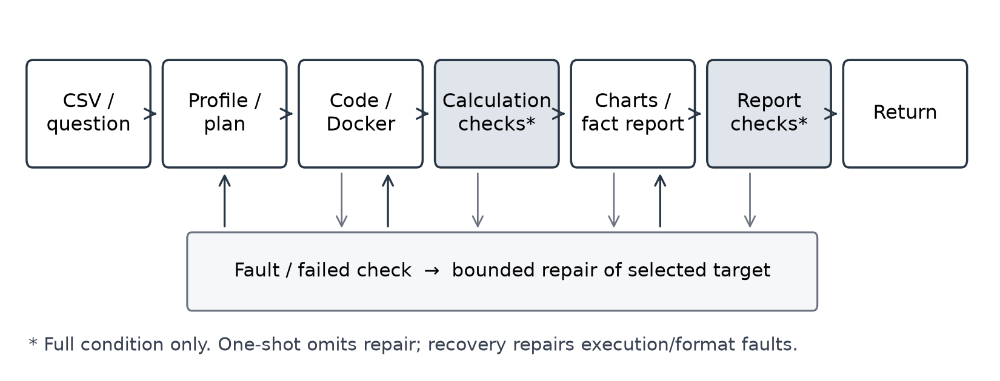

# A Local Tabular Analysis Agent with Bounded Verification and Repair

**Working draft — 17 November 2026.** Main model: Qwen3.5-9B Q4. Submission: 25 November; the final report uses the proposal template and has a ten-page limit excluding references. This Markdown source is not yet a formatted submission. All measurements below are development evidence. The planned human reference/family review has been revised to an external model-assisted audit. The external audit through SudoCode returns the configured `gpt-6.1-sol` identifier. A completed initial audit prompted further checks against actual development plans; these identified task-family overlap and inconsistent boundary judgments. The revised catalog and explicit family policy passed the final global/history audit and complete independent reference comparison before formal agent inference. The configuration is frozen and the formal grid is running. Audit token use is logged separately; dollar cost is unknown because provider rates are not configured. These checks are not agent outcomes. Complete formal outcomes and two-rater scoring remain outstanding. This is a protocol change from the proposal, not evidence of human-equivalent review accuracy. The [archived working draft](../docs/REPORT_DEVELOPMENT_HISTORY_20261116.md) preserves the longer development history.

## Abstract

Natural-language table analysis can fail through an incorrect analysis plan, incorrect code, or an unsupported explanation, even when a program executes successfully. We implement a local single-table agent that plans analyses, generates pandas code, executes it in Docker, renders charts and reports, and performs bounded verification and repair. All experimental conditions share declared-input preprocessing and a report interface that binds selected computed facts to their labels and valid sample counts. The full condition adds independent CSV recomputation, narrow request checks and a separate review call to the same model. Development runs expose both useful corrections and persistent limitations: calculations may agree with the plan while violating the request, and a reviewer may accept incomplete or unsupported prose. **Formal results and the final research conclusion remain to be added after the complete frozen experiment and human scoring.**

## 1. Introduction and research question

A table-analysis assistant should translate a question into the right population, measure, aggregation and display, then explain what the computed evidence supports. These requirements are distinct. For example, independently recomputing revenue under a declared date filter does not establish that the filter selects the requested month. Correctly citing an hourly mean does not establish that the hour represents commuting activity.

We study whether verification and bounded correction improve the reliability of a locally deployed language-model agent under a fixed resource budget. The three task tiers are explicit statistical questions, specified visualizations and open-ended exploration. Our practical priority is reliable statistics and charts; exploration remains part of evaluation, with its limitations and failures reported.

The system follows the interaction between reasoning and tools exemplified by ReAct [1] and bounded feedback/refinement approaches such as Self-Refine [2]. LIDA [3] motivates treating visualization as a multi-stage analysis task, while DSBench [4] provides broader context for evaluating data-science agents. Our contribution is an implemented, instrumented comparison in a restricted single-table setting, rather than a new general reasoning algorithm.

The main question is: **under the same model, inputs and resource caps, does verification with bounded repair improve task outcomes enough to justify its latency and token cost?** We separately assess whether a failure is detected, whether a correction succeeds and whether a previously usable result regresses.

## 2. System

### 2.1. Workflow and common components

A Streamlit application accepts one CSV, a natural-language question and optional field documentation. Profiling records types, missingness, examples, numerical summaries and a CSV hash. LangGraph maintains the plan, generated program, execution artifacts, report candidates, feedback and budgets.

The plan declares conversions, derived fields, filters, missing-value policy, grouping, aggregation, sorting, output limits and chart specifications. Repairs of structurally and field-valid plans use sparse field updates against the saved plan: omitted/null fields retain their values, removals are explicit, and the merged plan is revalidated. This reduces accidental omission without guaranteeing a correct edit. Initial planning and structurally invalid candidates still use a complete plan. It may link verbatim excerpts of the request to intended analyses. These links are a proposed coverage map; validating an excerpt does not establish that every requirement is covered. An essential ambiguity can trigger a clarification. The CLI and evaluation runner support one prewritten reply in the same run without resetting the budget.

**Figure 1.** Full workflow, with verification stages shaded. One-shot omits verification and repair; error recovery omits verification and permits execution/format repair. Repairs target the plan, code or report within shared budgets.

Shared preprocessing applies declared conversions and derived fields, then prepares an independent input frame for each analysis with its declared filters and missing-value rules. Aggregate inputs retain all-missing groups so undefined means and zero valid counts remain representable. The model generates aggregation, output columns, sorting and limits from these inputs. Both the raw generated program and the effective script are saved with hashes and preparation row counts. All conditions share this machinery; preprocessing implements the plan and does not certify its suitability.

Generated code runs only inside a non-root Docker container, with network disabled, read-only inputs and root filesystem, a writable artifact directory, and time/resource caps. Matplotlib renders bar, line, scatter and histogram charts from saved tables. Actual artist arrays, labels and histogram bins are retained for checking. Multi-table joins, predictive modeling and causal inference are outside scope.

### 2.2. Reports and evidence

The model selects one to four computed fact IDs for each of at most three findings and may add a short qualitative interpretation. A compiler inserts the measure, group labels, values and valid counts in fixed positions and attaches resolvable references. A mean based on one valid observation gets an explicit caution; empty outputs and undefined statistics remain explicit. The current catalog exposes up to twelve preview rows plus numerical extrema witnesses from the complete saved output. Full tables remain available; a limited output does not establish a population extremum.

The latest interface adds compiled maximum/minimum witnesses, extrema comparisons and observation-count ranges. Ties are explicit and statements are scoped to the complete saved output. Scalar missing-entry counts with matching declared filters may be compared across fields, explicitly as counts rather than rates. A narrow runtime wording rule rejects free-form ranking/comparison/significance terms in findings and requests computed facts instead; conditional limitations remain possible. It does not recognize all paraphrases or establish general semantic correctness.

A short decoding pattern excludes ASCII digits and braces from qualitative fields. Runtime validation additionally rejects Unicode number characters and terminal controls. Numeric field names and category labels remain usable through bound facts. The model also sees a minimal example with an actual fact ID and an empty interpretation. Invalid responses, full parser diagnostics and billed usage are saved; repair feedback contains a bounded set of field locations and errors. The program does not strip numbers from invalid responses or count them as successful reports.

This interface authenticates a fact's location in computed output. It does not establish that the output is correct or that the model's interpretation is true. It can also leave awkward prose when the model attempts a numerical sentence without its number; the development results explicitly retain this failure mode.

### 2.3. Verification, repair and budgets

Independent verification reconstructs supported sums, means, counts, missing counts, ratios and non-grouped Pearson correlations with separate CSV/math routines. It checks grouping, valid counts, sorting and chart/table agreement without reusing the pandas preprocessing helpers. Complete numeric raw observations and unambiguous sorted subsets have additional checks. Unsupported sampling, ambiguous subset ties and unsupported operations remain uncovered.

Narrow checks assess selected request constraints. These include explicit named scalar-sum requests, certain single-month requests, and a narrow English Top-K form with actual column names. The ranking check validates the named statistic/group, limit, primary value direction and explicitly requested tie order; ambiguous, negated, weighted or within-group forms remain outside this rule. For an untyped ISO date range, the current checker independently compares actual membership against the requested calendar month, holding other declared filters fixed. Matching membership passes for that snapshot; extra or omitted rows fail. Missing or unsupported date evidence remains uncovered. This replaces a conservative rejection of every untyped range, and does not establish general lexical-date safety or natural-language request verification.

The full condition checks calculations immediately after successful execution, before spending on charts and report drafting. After drafting, deterministic checks compare chart artifacts, resolve report facts and apply narrow wording rules. If no deterministic failure remains, a separate call to the same model assesses each finding, limitation and whole-request coverage; otherwise semantic review is deferred until repair. These stages count as one logical verification invocation per candidate, with separate active durations. A completed or failed report review cannot be reused for a free retry. A calculation-only inspection cannot promote a candidate to a reviewed final report.

Feedback can target the plan, code or report. New plans require fresh code and execution; report-only repair can reuse the saved calculations. Previous attempts and failures remain available. The controller stops at exhausted budgets, insufficient reservation or repeated unresolved errors. Failed tools and model outputs consume the same caps as successful ones.

Current additional plan/code/chart review issues must name an actual artifact location and quote its content. Report statements retain their own required verdicts, and report-repair guidance supplies available computed comparisons. A report quote cannot serve as an actual chart-label quote. This constrains feedback provenance and routing, while leaving the reviewer's error judgment heuristic.

Each run permits at most twelve tool invocations, three corrections and 100,000 cumulative model tokens. Model output is capped at 6,144 tokens with a 16,384-token context. All stages use Qwen3.5-9B Q4 with thinking disabled, temperature 0.7, top_p 0.8, top_k 20, repeat penalty 1 and presence penalty 1.5; the initial seed is 42. The evaluation host is an Apple M5 with ten CPU cores and 24 GiB memory; execution containers use two CPUs and a 2 GiB limit. Model/image digests, dependencies and hardware are recorded in each run.

`checks_passed` means applicable automated checks and model review reported no unresolved failure. It is not a human whole-task pass, and uncovered checks remain visible.

## 3. Data and evaluation

### 3.1. Data and conditions

| Dataset | Recorded rows | Analysis scope |
| --- | ---: | --- |
| UCI Online Retail [5] | 541,909 | Transactions; positive-sales tasks specify cancellation, quantity, price and date constraints; revenue is Quantity × UnitPrice. |
| UCI Bike Sharing [6] | 17,379 | Hourly table; weather normalization and category meanings use the supplied documentation. |
| UCI Adult [7] | 48,842 | Combined supplied files; unweighted sample descriptions unless weighting is explicitly requested. |

Source URLs, licenses, preprocessing and hashes are recorded locally; the dataset pages list CC BY 4.0. The study concerns new tasks on three known datasets, not unseen-domain generalization.

| Condition | Behavior |
| --- | --- |
| One-shot | One plan/program/report workflow without correction or explicit verification. |
| Error recovery | Allows execution and format recovery, without independent verification or semantic review. |
| Full | Adds programmatic checks, same-model semantic review and bounded correction. |

Conditions share data, documentation, profiling, preprocessing, report interfaces, libraries and resource caps. The tested agent's same-model review cost is included in its full condition. One-time external reference-audit cost is recorded separately and is not part of the agent-condition comparison. Neither the agent nor its same-model reviewer receives the evaluation reference answers. The comparison measures the verification package under a cap; it does not isolate the effect of one checker.

### 3.2. Frozen formal protocol

The protocol contains six development tasks and thirty held-out base tasks: twelve explicit questions, twelve visualization tasks and six explorations. Twelve variants add numeric strings, mixed unambiguous dates or missing entries. Including variants, the frozen grid is forty-two inputs × three conditions × two repeats, or 252 runs. All forty-two inputs expect a direct substantive answer. Incidental clarification is recorded, but this grid does not empirically test the supported prewritten clarification-response workflow.

The proposal's independent-human reference/family review has been revised to an external model-assisted audit using SudoCode's Chat Completions-compatible endpoint, configured as `gpt-6.1-sol`. For each deterministic task, the auditor sees the question, documentation, columns and three formatting examples, but no existing answer, reference implementation or agent output. It generates independent code for network-disabled local execution and complete-table comparison. Exploration tasks receive scope/scoreability review without a fabricated unique answer. The relay's returned identifier does not independently verify model identity; correlated model errors remain possible. The pre-test audit also flagged one retained chart prompt's "GBP per line" axis wording: it explicitly requests the unweighted mean of UnitPrice across transaction lines, but the documented measure is GBP per unit. The numerical reference follows that mean, and pre-test rater guidance clarifies the documented unit; the ambiguity remains a limitation of that item. Audit tokens and failures are recorded separately, with dollar cost unknown because pricing is not configured. The final candidate required fifty-five saved responses, including incomplete programs for two tasks, their explicit supplements and one code-array transport adaptation. All forty deterministic reference tables matched; eight exploratory tasks received scope review. Across all pre-test revisions, 174 responses report 459,903 input and 151,359 output tokens, with two responses lacking token measurements. These audit calls are separate from Qwen outcomes and condition costs.

A question-text-only family check initially missed overlap. We therefore reviewed actual attempted development plans, including failed attempts and early/application runs. Conflicting model judgments prompted a written operational boundary: shared primitives alone do not establish rehearsal, while the same substantive target/template with altered dates, subsets, group labels or display remains exposed. Revisions removed rehearsed weather associations, temporal coverage, Adult age/education and capital-gain comparisons, general category-composition exploration, and direct supplied-weight summaries potentially exposed through failed ratio intermediates. No Qwen formal-test outputs informed these revisions. The revised test catalog has eight conservative connected families; exploratory tasks can connect several narrower tests, which remain together with their variants for resampling. This is new-request evaluation on familiar data and operations, with few family-level units and limited inferential strength. The revised audit and source/configuration freeze are complete; formal inference is underway and two-human-rater scoring remains pending.

Numerical tables use exact agreement for categories/counts and floating-point tolerances of relative 1e-4 and absolute 1e-6. A numerical match means that at least one saved table in the selected candidate agrees with the complete reference, including required counts, grouping and ordering. It does not certify additional analyses or a correct textual answer. A missing selected output fails this numerical metric; earlier matching computations remain separate candidate evidence. Explicit tasks also require correct scope and explanation. Visualization scoring covers data, type, axes/units/labels and legibility, each on a 0–2 scale; a pass requires correct data, explicit constraints and at least 6/8. Up to three exploratory findings receive correctness, grounding and usefulness scores of 0–2. A response with no substantive finding receives zero; an absent extra finding is not automatically penalized.

The proposed two raters score independently before adjudication. Agreement, clarification outcomes, failure/recovery, robustness and costs are reported separately. Repeats are averaged within task; paired exploratory intervals resample task families within each dataset while retaining clean/variant dependence. **Formal outcome tables, agreement statistics and intervals are pending.**

## 4. Development evidence and failure taxonomy

Development informed the implementation and the task-family audit. Its repeatedly inspected tasks are excluded from formal outcome claims. Complete runs and failed attempts remain in the [development evidence ledger](../docs/REPORT_DEVELOPMENT_HISTORY_20261116.md); successive versions are not pooled as one controlled experiment.

The last complete six-task, three-condition development cohort used source 8d392f7, one repeat per cell and the fixed 9B configuration. Its eighteen terminal outcomes were seven failures, seven unverified completions, three internal passes and one budget stop. Across four explicit/chart tasks, the selected table matched the external development reference in two of four tasks in every condition. The cohort consumed 386,010 tokens and 2,583.59 seconds. Artifact hashes and token ledgers were verified. These are development and numerical-table measurements, not human whole-task scores.

Four recurring failure types shaped the final system:

* **Plan/request mismatch.** A Retail date filter executed consistently but selected extra records outside the requested month. Another plan sorted product identifiers before the requested quantity ranking. Independent calculation checks alone accepted the declared computation. Narrow month-membership and Top-K checks were added to cover these concrete cases.
* **Repair damage or ineffectiveness.** Replacing a complete plan could lose an existing revenue derivation. Sparse updates reduced this risk for structurally valid plans, while invalid plans retained complete-plan transport. A prespecified two-run final follow-up retained D2's corrected ranking and a matching table, but D1 repeated its wrong date filter and failed. Field preservation does not establish effective correction.
* **Output-contract failure.** Numerical prose violated the fact-bound report schema, and some exploration responses truncated at the output cap. Binding numbers and labels programmatically and supplying an actual fact-ID example reduced some formatting failures. They did not guarantee a complete report; failed calls consumed the same budgets.
* **Unsupported interpretation and review error.** A correct hourly mean was interpreted as commuting behavior; education extrema were misranked or described with unsupported significance. Same-model review sometimes accepted these claims. Computed extrema witnesses and anchored review evidence improved provenance, but did not establish general semantic reliability.

The final targeted plan-repair follow-up used source 3a7623a, unchanged model/settings and two prespecified full-condition tasks. Both terminal outcomes and all 55,111 tokens/267.31 seconds were retained: one matching corrected result and one failure. This small diagnostic is not a replacement for the complete formal grid.

A separate real-Chrome integration case uploaded a six-row CSV and requested total rentals, valid count and a weather bar chart. It completed without repair in 102.17 seconds and 18,481 tokens. Saved tables and chart arrays agreed: total rentals 152 over six observations; Clear 67/3, Misty 28/1 and Rain 57/2. The result page's actual HTTP export matched all seventy-one ZIP entries and excluded the raw CSV. Automation fetches that registered resource without clicking Download because Chrome's native Save As dialog cannot be completed by the browser connector. Native dialog completion is outside this check. The later shared-export refactor did not alter the analysis logic.

## 5. Formal results — pending

The forty-two-input, three-condition, two-repeat grid is running on the frozen configuration. The first direct-script launch failed at import before cohort creation or model calls; the module entry then started the unchanged grid. The preflight error and appended logs remain retained. Numerical table matches, chart-array consistency, execution/report availability, repair/regression and all-run token/time costs will be summarized separately. Whole-task explicit and chart passes, exploratory quality and rater agreement require two actual independent human ratings. No pending metric is imputed as zero or replaced by the system's internal verdict.

## 6. Discussion and limitations

The architecture separates three checks that are easy to conflate: whether code implements the plan, whether the plan implements the request and whether the explanation is supported. Common preprocessing improves enforcement of declared transformations, but can faithfully execute a wrong plan. Bound facts preserve labels and numbers, but the model can still write an unsupported interpretation or an incomplete sentence.

Same-model review can repeat assumptions, miss contradictions, propose incompatible repairs or route a report issue into unnecessary replanning. An internal pass cannot substitute for independent task assessment. Narrow deterministic checks improve specific covered cases while leaving unsupported requests explicit; they do not establish general verification.

The development sample is small, uses one repeat per cell and has been repeatedly inspected during implementation. It cannot establish held-out answer quality, exploration usefulness, human chart legibility or robustness. The initial model-assisted audit missed development/test overlap until actual attempted plans were supplied. Boundary judgments also varied across requests. The final model-assisted audit passed after these revisions; no human reference review or human-equivalent review accuracy is claimed. The eight connected test families, and only four exploration-bearing families, limit the strength of resampling intervals. Intended output raters are team members. Sequential task/condition ordering, cache state and hardware load also limit causal latency comparisons. Local document rendering and source-portability checks ran during the grid; no controlled cold-start or isolated-host timing study is claimed. Process RSS measurements exclude Metal allocations and the Docker VM.

The remaining evidence is the complete frozen formal experiment, actual human ratings, and a category-level analysis of quality, recovery/regression, robustness and costs. Correlated errors between language models remain possible; numerical agreement cannot establish that the task itself is valid. The current evidence supports an instrumented prototype and concrete failure/correction cases; it leaves the primary research question open.

## 7. Reproduction and completion

[README](../README.md) documents installation, local services, executor setup and UI/CLI use. [The local completion plan](../docs/LOCAL_COMPLETION_PLAN_ZH.md) records deadlines and the ten-page allocation. [The evaluation guide](../evaluation/README.md) documents freezing, resumption, blind material preparation and scoring. Every run preserves input/source snapshots, hashes, model inputs/raw responses, plans, execution, charts, report candidates, feedback and resource ledgers. User downloads exclude the raw CSV by default. Formal evidence must replace pending fields before final conclusions are written; development runs must remain labeled as such.

## References

[1] Shunyu Yao et al. ReAct: Synergizing Reasoning and Acting in Language Models. arXiv:2210.03629, 2022. <https://arxiv.org/abs/2210.03629>.

[2] Aman Madaan et al. Self-Refine: Iterative Refinement with Self-Feedback. arXiv:2303.17651, 2023. <https://arxiv.org/abs/2303.17651>.

[3] Victor Dibia. LIDA: A Tool for Automatic Generation of Grammar-Agnostic Visualizations and Infographics using Large Language Models. arXiv:2303.02927, 2023. <https://arxiv.org/abs/2303.02927>.

[4] Liqiang Jing et al. DSBench: How Far Are Data Science Agents from Becoming Data Science Experts? arXiv:2409.07703, 2024. <https://arxiv.org/abs/2409.07703>.

[5] Daqing Chen. Online Retail. UCI Machine Learning Repository. <https://doi.org/10.24432/C5BW33>.

[6] Hadi Fanaee-T. Bike Sharing. UCI Machine Learning Repository. <https://doi.org/10.24432/C5W894>.

[7] Barry Becker and Ronny Kohavi. Adult. UCI Machine Learning Repository. <https://doi.org/10.24432/C5XW20>.
